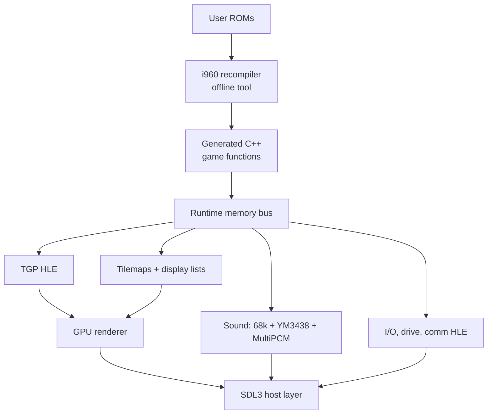

# Daytona USA (Model 2) Static Recompilation — Design Document

Sep 24, 2026 · Ben

## Overview & goals

We statically recompile the i960 game code of Daytona USA (Sega Model 2, 1994) into portable C++, and replace every other board subsystem with high-level or reused emulation, to ship native builds for Windows, macOS and Linux. MAME is the behavioural oracle during development; an original Model 2 PCB is the ground truth when MAME and our build disagree.

**Goals**

- Native x86-64 and ARM64 executables on Windows, macOS (Apple Silicon + Intel), Linux, Android and Raspberry Pi (64-bit Pi OS), from one codebase.
- Frame-exact gameplay parity with the arcade: timing, physics, AI, attract mode, all three courses, all cars.
- User-supplied ROMs only. The repo ships the recompiler, runtime and a ROM-to-build pipeline, never Sega code or assets.
- Modern presentation as opt-in: native resolution, widescreen, higher internal refresh for rendering, filtered textures.
- Real hardware for input: wheel, pedals, 4-speed shifter, force feedback, and cabinet link play over LAN.

**Non-goals (v1)**

- Other Model 2 titles. The recompiler stays generic, but runtime HLE targets Daytona's code paths first.
- Daytona USA 2 (Model 3, PowerPC) and the Saturn / PC ports.

## Target hardware summary

Daytona runs on the original Model 2 board (MAME set `daytona`, driver `sega/model2.cpp`, machine `model2o_state::daytona`), not 2A/2B/2C, so the geometry processor is the Fujitsu TGP rather than a SHARC or TGPx4.

Figures below are confirmed against MAME at `dddd7368` (`src/mame/sega/model2.cpp`, `src/mame/shared/segam1audio.cpp`) and cross-checked against the Model 2 MiSTer core at `591e148e`. They are MAME's figures, not hardware measurements: rule 11 still applies, and the PCB settles anything marked provisional.

| Subsystem | Part (MAME) | Clock (MAME) | Strategy |
| --- | --- | --- | --- |
| Main CPU | Intel i960KB (`I80960KB`), little-endian | `50_MHz_XTAL / 2` = 25 MHz | Static recompilation to C++ |
| Coprocessor | One Fujitsu MB86234 TGP (`m_copro_tgp`); MAME's MB86234 is an empty subclass of its MB86233 | `50_MHz_XTAL` = 50 MHz | Its uploaded program statically recompiled to native C++, validated against MAME's LLE TGP |
| Geometrizer | Separate from the TGP: walks the display list in buffer RAM at vblank (`geo_parse`, `model2_v.cpp`) | — | Reimplemented; MAME's version is HLE |
| Rasterizer | Sega custom chips; MAME has no device, it is driver code | — | Replaced by host GPU renderer |
| 2D tilemaps / HUD | `S24TILE` (System 24 tilemap chip) | — | Reimplemented, composited on GPU |
| Screen | `set_raw(32_MHz_XTAL/2, 656, 0, 496, 424, 0, 384)` | 16 MHz pixel clock | 496x384 active, 656x424 total |
| Sound | Model 1 sound board (`SEGAM1AUDIO`): 68000 + YM3438 + 2x MultiPCM | 68000 `20_MHz_XTAL / 2` = 10 MHz, YM3438 8 MHz, MultiPCM 10 MHz each | 68000 program statically recompiled (same pipeline as the i960); FM/MultiPCM chips as native C++ |
| Main ↔ sound | i8251 UART (uPD71051C) at 0x01c80000 | 31.25 kbit/s (`16_MHz_XTAL / 2 / 16`) | Serial byte stream, not a latch |
| I/O | Model 1 I/O board (`SEGA_MODEL1IO`, BIOS `epr14869c`): own Z80, talks through an MB8421 dual-port RAM at 0x01c00000 | Z80 `32_MHz_XTAL / 8` = 4 MHz | HLE of the dual-port RAM protocol, SDL3 mapping |
| Drive board | SJ25-0207-01 / 838-10646: Z80 + 2x 315-5296 + MSM6253 ADC; commands arrive through the I/O board | Z80 `XTAL(8'000'000)/2` = 4 MHz, "confirmed" | HLE: decode commands, map to SDL haptics |
| Comm board | 837-10537: Z80 + uPD72103 HDLC, program EPR-16726; MAME simulates it (`M2COMM`), no Z80 runs | — | HLE shared-memory protocol over UDP |
| Timers | 4 down-counters at 0x00f00000 | 25 MHz | Runtime device |

**Derived timing.** Refresh = 16,000,000 / (656 x 424) = **57.524 Hz**. Line rate = 16,000,000 / 656 = **24.39 kHz**: medium resolution, not 15 kHz. MAME marks this line `// TODO: from System 24, might not be accurate for Model 2`, so the blanking figures are provisional until measured on a PCB.

**Interrupts.** The board has a 12-bit request register (0x00e80000, write-to-acknowledge by AND) and enable register (0x00e80004, updated 80 ns after the write). MAME routes it to the four i960 lines:

| Request bits | Source in `daytona` | i960 line |
| --- | --- | --- |
| 0 | vblank | IRQ0 |
| 1 | nothing in MAME | IRQ1 |
| 2-5 | timers 0-3 (bits 6-9 unused) | IRQ2 |
| 10 | UART RxRDY or TxRDY | IRQ3 |
| 11 | nothing in MAME | IRQ3 |

Priority is not fixed by the board. MAME takes each line's vector from the i960's ICR and uses `priority = vector / 8`, so the ordering is whatever Daytona programs. **Measured (MAME, `daytona93`):** Daytona sets ICR = `0f0e0d0c` once at boot, so IRQ0-3 take vectors 0x0c-0x0f and all four run at priority 1; no line pre-empts another. In attract only vblank (vector 0x0c, handler 0x0e00) and the sound UART (0x0f, handler 0x0f50) fire; the timers never do. On vblank MAME runs `geo_parse` first (when 60 Hz mode is set, or on even frames in 30 Hz mode, per `videocontrol` bit 0) and then raises bit 0.

**TGP program.** The TGP has no microcode ROM. It holds in halt from reset until the i960 uploads its program: setting `coproctl` bit 31 (0x00980000) routes FIFO writes at 0x00884000 into the 4 K-word program RAM, and clearing it boots the TGP. Daytona's program is 2,024 words, stored in the game's own data ROM (MiSTer core, `tools/extract_tgp_microcode.py`). On the CPU board, `opr-14742a`/`14743a` (`copro_tgp_tables`) are the tables behind the TGP's sin/cos, atan, 1/x and 1/sqrt I/O ports; MAME labels `opr-14744`..`14747` (`other_data`) as further 1/x and 1/sqrt tables. MAME runs this microcode at low level.

## Architecture

The build has three layers: generated game code, a Model 2 runtime that stands in for the board, and a thin host platform layer. Generated code only ever touches the machine through the runtime's memory bus, so the same output runs under a trace harness or in the shipping executable.

The recompiler runs at build time on the user's machine, so no generated Sega code is ever distributed.

**Frame loop.** One host frame = one Model 2 video frame. The runtime runs generated code until the game waits on vblank, fires the vblank interrupt handler, drains the TGP FIFO into a display list, then renders and presents. The sound board then advances one frame of board time on the same thread (see Audio).

**Memory bus.** Main RAM, work RAM and shared RAM are flat host arrays accessed inline. MMIO ranges (TGP FIFO, geometrizer, tilemap RAM, palette, I/O dual-port RAM, sound UART, comm RAM) go through a page-table of handlers, resolved at compile time where the address is constant.

**No fallback.** Every instruction the game runs is statically recompiled to native code. There is no interpreter in the shipped build. A jump to an address with no recompiled code is a hard error that names the address; the fix is to add it to `seeds/daytona93.txt` and recompile. The runtime (`src/runtime/cpu`) holds the i960 context and the services generated code calls (call/return with the register cache, interrupt entry, memory); it has no interpreter. The reference interpreter in `src/refcore` exists only for the test harness (`m2replay`) and is never linked into the game (`m2native` does not link it).

## i960 static recompiler

The recompiler turns the program ROM into one C++ function per i960 procedure, preserving the architectural register file in a context struct so behaviour matches instruction-for-instruction. Optimisation (register promotion, flag elision) comes after parity, never before.

**Pipeline**

1. Load and de-interleave the program ROMs into a flat image using MAME's ROM map for `daytona`.
2. Seed entry points: reset vector, the interrupt table, the fault table, the system procedure table (for `calls`), and any addresses from a hand-maintained `seeds.toml`.
3. Recursive-descent disassembly over the four formats (REG, COBR, CTRL, MEM). Follow `call`, `callx`, `bal`, `balx`, branches and compare-and-branch.
4. Resolve indirect targets: pattern-match jump tables (`ld` from a scaled index then `bx`/`callx`), and merge in targets observed by the MAME tracer (see Reference & validation).
5. Build a CFG per procedure, then emit C++ with one label per basic block and `goto` edges.
6. Emit a dispatch table (address → function pointer) for all indirect calls; a miss is a hard error naming the address (no fallback).

**Decoder** (`src/i960`, shared by `i960dis` and the recompiler)

- Decoding follows MAME's *executor* (`i960.cpp`), not its disassembler: the executor is the behavioural oracle. The accepted set is exactly what the executor implements: 62 CTRL/COBR/MEM opcodes and 102 REG opcodes. Anything else MAME's disassembler knows (Cx/Hx/Jx additions, `cmpibno`, `cmpibo`, `atadd`, `bswap`, ...) decodes but is marked not executable; the recompiler refuses it. `0x6e1` is decoded as `movre`, as MAME executes it; it is undocumented.
- Text output reproduces MAME's disassembler syntax exactly, so the two can be diffed as strings (`tests/mame_oracle.cpp` compiles MAME's `i960dis.cpp` unmodified against a small shim).
- Three encodings are read differently by MAME's executor and disassembler. The decoder follows the executor and flags each one (`Insn::quirks`); hardware behaviour for all three is unconfirmed, and any occurrence in Daytona's code is a finding:
  - CTRL/COBR bits 1:0 set: the executor adds them to the branch target (`sext(opcode, 24) - 4`); the disassembler masks them.
  - MEMB bits 6:5 set: the executor ignores them; the disassembler rejects the word.
  - MEMB scale > 4: the executor shifts by it; the disassembler rejects the word.
- The i960 manual (270567-001) is not yet a second check on the decode; the Ghidra SLEIGH cross-check below is the planned one.

**Ghidra as the analysis workbench**

> **Correction (checked 24 Sep 2026):** mainline Ghidra has never shipped an i960 processor module: none in `Ghidra/Processors` at `8e9a8e7a`, none in the last 40 release tags back to 9.2, and no i960 path anywhere in its history. The module in use is the third-party [mumbel/ghidra_i960](https://github.com/mumbel/ghidra_i960) (Apache-2.0, pinned at `727ef787`, fetched by `scripts/fetch_ghidra_i960.sh`), which loads into Ghidra from `Ghidra/Processors/` and into pypcode for the decoder cross-check.
>
> **Cross-check result** (`tests/ghidra_oracle.py`): all 23,258 statically reachable Daytona instructions decode identically in our decoder and in SLEIGH (validity, mnemonic, length, target, operands). On 1,000,000 random words the only differences left are (a) MAME's disassembler printing the integer src1 of `cvtir`/`cvtilr`/`scaler`/`scalerl` as an FP register (MAME's executor and SLEIGH both read an integer; text only), and (b) `movre`: MAME executes 0x6e9 and the undocumented 0x6e1, the module decodes only 0x6e1. Encodings that set bits the KB reserves are flagged as decoder quirks and counted, not compared; none occurs in reachable code.

- Load the de-interleaved program image into Ghidra with its i960 processor module. It becomes the shared, annotated map of the game code.
- Use it to name functions, mark jump tables, label MMIO accesses (TGP FIFO, sound UART, I/O dual-port RAM, comm RAM) and document data structures such as car state and course tables.
- A Ghidra script exports function starts, names and jump-table targets into `seeds.toml`, so every name reaches the generated C++ and trace logs read as `update_car_physics`, not `sub_0001A3F0`.
- Cross-check our disassembler against Ghidra's SLEIGH decode: any mismatch in instruction length, operand or branch target is a bug in one of them. Confirm which i960 variant the module models, since KB FP instructions matter here.
- Findings from MAME traces (indirect targets, code executed from RAM) are imported back into the Ghidra project so the map stays complete.

**Register and state model**

- `ctx.g[16]` globals (g15 = frame pointer), `ctx.r[16]` locals (r0 PFP, r1 SP, r2 RIP), `ctx.ac`, `ctx.pc`, `ctx.tc`, and `ctx.fp[4]` for the i960KB's extended FP registers.
- The condition code lives in `ac`; emit it lazily and only materialise it when a later `bx`/`test`/`modac` or a call boundary reads it.

**Calls and the local register cache**

The i960 saves the 16 local registers on every `call` and restores them on `ret`, via an on-chip cache that spills to the stack frame. The recompiled `call` becomes a C++ call plus an explicit save of `r[]` into the new frame's memory, so code that walks frames or does `flushreg` sees the same stack bytes as hardware. `bal`/`balx` are leaf links through g14 and compile to plain calls with no local save.

**Floating point**

The KB's FPU works in 80-bit extended precision, which ARM64 hosts lack. Any FP op whose result can reach memory or a compare goes through SoftFloat `extF80`; a fast path uses host `double` only where a unit test proves bit-identical results. Physics divergence from wrong rounding is the likeliest source of replay desync, so this is tested first.

**Measured FP use (MAME harvest, `daytona93`).** Of the 23,258 instructions statically reachable from 333 harvested entry points, 108 are FP, and all are conversions, compares and scaling: `cvtri` 39, `cmpr` 37, `cvtir` 22, `scaler` 8, `cvtzri` 2. There is no FP add, subtract, multiply or divide, no transcendental and no `...rl` (extended) form. The geometry maths is on the TGP. 21 of 68 indirect sites are still unexercised, so unreached code may add more; re-measure as coverage grows. For these five operations the extF80 path is small and each can be tested exhaustively or near it.

**As built** (`src/i960/fp.{h,cpp}`, measured operand forms: every one of the 108 FP instructions takes g/l registers, i.e. single precision in and out; never fp0-fp3 or FP literals; AC = `3f001000`, round to nearest, all exceptions masked):

- `ref_*`: the candidate hardware model. Operands widened to extF80, computed and rounded by SoftFloat 3e in any AC rounding mode, IEEE flags reported. Its invalid conversions all return `0x80000000`; that blanket rule is not a verified model of every i960 conversion (see the manual correction below).
- `fast_*`: separately tested native host operations, round to nearest/ties-even only. Contrary to the earlier wording, the current recompiler does NOT call these for cvtri: `tools/m2recomp/main.cpp` emits `gen::round_to_int` with ties-away in mode0. The native vehicle import retains that finite PC-reference behavior. Historical `tests/test_fp --exhaustive` results compare fast_* against ref_*, not the active generated path: every 2^32 input for cvtri, cvtzri and cvtir, and every 2^32 single for scaler at 11 boundary exponents, 0 mismatches (about 5 minutes on 4 cores). A fast path that rounds like MAME (`std::round`) fails that comparison with 130,905 mismatches in the quick run.
- A different rounding mode, or FP on fp0-fp3, would not have a proven fast path and must go through `ref_*` until one is proven.

**MAME is not a bit-exact FP oracle.** MAME's i960 holds `fp0`-`fp3` as host `double` (`i960.h`, `double m_fp[4]`) and computes in `double`. Wherever Daytona's results depend on the extra bits of extended precision, correct extF80 output and MAME's output disagree, and the lockstep diff will report it. Unresolved; see Open questions.

**Manual correction, 2026-10-03.** Intel's public
[80960KB Programmer's Reference Manual, March1988](https://www.arithmazium.org/classroom/lib/Intel_80960KB_Programmers_Reference_Manual_Mar88.pdf),
page12-23, specifies INT32_MIN for a masked NaN-to-integer conversion and sets
the invalid-operation flag. Page11-50 separately specifies signed endpoint
saturation for unrepresentable magnitudes. Both pages were visually checked.
Do not conflate these cases or claim all invalid conversions are verified by
the existing SoftFloat specialization. The native yaw import now handles
masked NaN explicitly; since 16 October 2026 finite and infinite overflow
saturate to the signed endpoint as page 11-50 says (AC 3f001000 masks integer
overflow, bit 12): live play reaches it in the yaw step (fbd0 converts -inf
when the front and rear wheel angles are equal), and the reference agrees on
every row after it (platform/dreamcast-native/tests/test_negative_speed_lockstep.py).
The scratch oracle substitutes only the documented NaN result before the
reference's undefined C++ cast. It does not claim CPU exception-flag parity.
No desktop rounding/conversion semantics were changed.

**Interrupts and faults**

- Interrupts are taken only at safe points: backward branches, calls and returns emit a cheap `if (ctx.irq_pending)` check that dispatches through the interrupt table with the proper `intctl`/priority rules.
- Faults (e.g. integer overflow, alignment) dispatch through the fault table; in practice we log and abort on any unexpected fault during bring-up.

**Code outside ROM**

If the game copies routines into RAM or patches code, the tracer will show execution from RAM. Those regions are recompiled from a RAM snapshot taken after the copy and checked by hash at runtime; a mismatch is a hard error.

## Geometry (TGP) and rendering

The TGP is replaced by C++ that consumes the same FIFO command stream the i960 writes, and the rasterizer is replaced by a modern GPU backend fed from an intermediate display list. This split lets us diff geometry output against MAME numerically, independent of how pixels end up on screen.

**TGP: statically recompiled**

- The i960 uploads the TGP's program, then pushes commands and parameters into the copro FIFO and reads results back from the output FIFO.
- The TGP has no fixed microcode: its whole program is the 2,024 words the i960 uploads from the game's data ROM (main_data 0x860020, CRC 0xd6d611dd). So the TGP gets the same treatment as the i960: `tools/m2tgprecomp` statically recompiles that program to native C++ (one label per word, MAME's MB86233 semantics inlined per instruction from `src/runtime/tgp.h`, direct gotos for constant branches, a switch for computed ones). No MB86233 interpreter or hand-written HLE; nothing is interpreted at run time. At boot the runtime checks that the uploaded words are the ones recompiled (hard error otherwise).
- Clockless coupling: the TGP runs only when the i960 needs it (reading the output FIFO or its status) and returns when it stalls on an empty input FIFO. FIFO contents are order-deterministic, so no cycle model is needed for them. **Measured**: `m2tgpcheck` replays MAME's TGP-side log and matches all of attract: 12,390,181 TGP instructions, all native, every register checked after every instruction, 1,293,703 input words, 398,072 output words and 7,789 banked accesses identical to MAME; 0.02 s without the per-instruction check. Also identical through a 6,000-frame race (230.6 M TGP instructions, 3.2 M banked accesses), time attack (97.7 M) and the TGP self-test (32.6 M).
- **Measured, native i960 + native TGP together** (`m2native` models the geometry ports, the TGP FIFOs and buffer RAM): attract, a 6,000-frame race and time attack match MAME, every TGP output word identical (6.7 M in the race) and the whole 128 KB buffer RAM hash identical at every sample (11,951 in the race). Buffer RAM is built from its three writers (the i960, the geometrizer command port, the TGP's banked writes). The only differing reads are the i960 polling the TGP's mailbox (the last three dwords of buffer RAM): our TGP has finished when the i960 looks, MAME's (paced by cycle estimates) has not. Rule for the shipped build: the TGP runs to its FIFO wait before the i960 reads the FIFO, its status or the mailbox; the game sees fewer poll iterations, nothing else.
- Two units share the geometry work: the TGP (programmable, results can return to the i960) and the geometrizer, which walks the display list in buffer RAM at vblank and transforms, lights, clips and projects polygons for the rasterizer. Which of the two does what for Daytona is established from traces, not assumed.
- MAME runs the TGP microcode at low level (MB86234 = MB86233 core); it is the oracle the recompiled program is matched against bit for bit, including its float rounding (host IEEE single, no FP contraction). MAME's geometrizer is HLE in host `float`, so it is a weaker oracle for display-list output than the TGP is for FIFO results.
- Any command that returns results to the i960 (e.g. collision or matrix readback) must return identical values, since game logic depends on them.

**Geometrizer: native HLE**

The original Model 2's geometrizer runs code from ROM inside its DSP; that code is not dumped, so there is nothing to recompile. It is native C++ transplanted from MAME's high-level implementation (`src/runtime/geo.cpp`): at vblank it walks the display list in buffer RAM, transforms, lights, culls and clips, and produces the polygon list. Measured against MAME at every vblank (same i960 instruction count), on our own buffer RAM: identical rasterizer input and kept polygons through a whole race (see Milestones). The rasterizer takes 24-bit floats (MAME's `f2u(x) >> 8`). Its libm calls (`hypot`, `sqrt`) are to be pinned to a correctly rounded implementation so all hosts agree.

**Display list**

One frame's output is a flat list: polygon (4 verts, screen xyz, uv, colour, texture page/format, translucency, fog, sort key) plus tilemap layer state. It is dumpable to disk, which makes renderer bugs reproducible without running the game.

**Renderer**

- Backend: SDL3 GPU API (Vulkan on Linux/Windows, Metal on macOS, D3D12 optional). One shader path, no per-platform shader forks.
- Textures: decode Model 2 texture RAM/ROM formats to RGBA8 atlases on upload, cached by content hash.
- Sorting: reproduce the hardware's priority/z-sort order first; a z-buffer mode is an enhancement toggle, since hardware ordering artefacts are part of the look.
- Tilemaps (HUD, speedometer, course map, text) render as a separate layer at native 496x384 and scale with nearest or sharp-bilinear filtering.

**Vita GXM presentation enhancements.** The Vita branch exposes the same
options described below, but the wide GPU tile capability is currently disabled
after hardware feedback reported worse speed. Widescreen uses the CPU tile
composition fallback; original-aspect GPU tiles and GPU 3D remain enabled.
The GPU tile implementation is retained for profiling, not claimed faster.

The retained implementation supports the same aspect, scenery-distance and
per-item HUD policies. Original
mode uses GPU System24 composition. Wide mode now uses the same GXM tile
compositor for its backdrop, with only background destination x coordinates
scaled when stretch is enabled. Unstretched margins use palette pen0, like
the original GXM clear. As in main3044f3b, foreground tiles also use GXM except
when per-item HUD relocation needs CPU composition. Tile decoding remains CPU.
Road subdivision additionally measures texture error using main's reciprocal
depth interpolation, targeting0.5texel edge-midpoint error within the existing
eight-way cap and pool limits. This remains an affine approximation, not
main's per-fragment shader, and can add vertex work. The previous Wide2 CPU backdrop remains
available when the explicit Vita GPU-background capability is disabled.
Unchanged foreground pixels reuse HUD grouping/uploads. The Vita stretch option
applies to all wide backdrops; desktop retains its exact 3D-coverage gating. The homogeneous-WVP and wide GPU tile changes were
withdrawn after IMG_2856 showed missing textured geometry on real hardware.
The previous affine subdivision path is restored. Road-line wobble and wide-mode
cost remain unresolved; host matrix tests did not validate actual GXM output. Fixed896x384 layer textures
cover up to21:9; panel fitting preserves aspect on960x544. The layer arena grows
from10 to12MiB (32MiB total GPU arenas), without per-frame GPU allocations.
These options are not a promise of full-speed hardware performance.

**Vita GPU buffering.** Upstream's Double Buffered / Single Buffered / Every
Third Frame labels select frame skipping, not physical buffer counts. That
Vita integration was withdrawn after hardware game/audio stutter reports.
The subsequent configurable physical ring has also been removed after a
hardware report of 30 FPS. Vita now uses unmodified upstream libvita2d
presentation and its standard three-surface display queue, with one vblank
wait in the display callback. There is no buffer selector, ring switching,
single-surface path or software frame skipping. Old gpu_buffers settings are
ignored. Native audio stays device-clocked and board timing stays native;
this rollback is not evidence of 60 FPS on hardware.

**Enhancements (all off by default)**

With every enhancement off the build is the game as MAME runs it; parity checks run that way. When on, an enhancement may change game logic (rules.md, changed 1 Oct 2026: previously "never change game logic", which ruled out widening the game's own culling).

| Option | Approach | Risk |
| --- | --- | --- |
| Internal resolution | Render 3D at N× or window size | Low |
| Widescreen | **Done** (launcher: 16:10, 16:9, 21:9). Same focal length, viewport widened: the geometrizer's side clip planes and the rasterizer's clip move out by a margin for full-width viewports, the 3D layer is drawn margin-shifted into a wider buffer, tilemaps (HUD, text) stay 496 wide in the centre, and the side margins continue the back tilemaps in 3D scenes (drawn margin to margin with draw()'s own scroll, layer-split and mask rules) or each row's edge colours on 2D screens. Option "HUD at the screen edges": the race HUD's side groups move out by the margin, decided per item (front-layer pixels grouped into blobs; a blob moves only if wholly inside a group, so banners crossing a group stay whole), plus the condition panel's own overlay quads (the polygons at its box's sort z inside its outline), only while that box is on screen. The scenery list includes nearby cells omitted by the game's narrow directional mask and retains course exclusions and the original selected-cell order | Widening selection can increase object-list work; the geometrizer still clips to the view |
| Draw distance and polygon budget | **Scenery done** (launcher slider: Shortest, Shorter, Default, Further, Furthest; polygon budget: Automatic or Custom; `m2run --draw-distance/--draw-budget`). The game draws scenery by course cell: a 16x16 grid, the 5x5 cells around the car filtered by visibility masks into a list (0x16f74..0x17070; count 0x5016c0, cells from 0x5016c1, room for 63), then object lists until a per-frame cost allowance (0x5010f4, 5000 at boot) is exceeded. At native height, Automatic uses `max(ceil(5000 * max(width, 496) / 496), 5000 * (1 + max(draw_distance, 0)))`, capped at 1,000,000. This gives 5,000 at original width, 6,875 at 16:9 and 9,033 at 21:9 with Default distance. A positive Custom allowance overrides that calculation. Correction: 0x13f5c's 14-entry window contains vehicles, not road sections; live entity-pool checks at frames 240/300 establish this. It is unchanged | Further adds scenery; road coverage requires separate analysis; cost allowance measures object metadata rather than visible polygon count |
| Texture filtering | Bilinear/anisotropic on atlases | Low; atlas padding needed |
| High frame rate | Interpolate display lists between frames | High; logic stays at native rate |
| MSAA | Standard multisample target | Low |

The headless `m2run` and `m2gpushot` tools can exercise the same scenery
selection and automatic budget at 32:9. The launcher remains limited to 21:9
until the wider view's sky boundary and presentation are addressed.

## Audio, inputs, force feedback, link play

Nothing here is interpreted either. A board whose CPU runs a program gets that program statically recompiled, like the i960 and the TGP; a board whose behaviour is a fixed protocol gets native C++ for that protocol (HLE). If an HLE turns out not to be exact, the board's own program is recompiled instead; there is no fallback to an interpreter.

**Audio**

- Daytona uses the Model 1 sound board, not the SCSP board later Model 2 revisions carry (see Target hardware summary). Its 68000 program (`epr-16489`/`16490`, loaded by the importer) is statically recompiled to native C++ by the same approach as the i960 (**done**): `src/m68k` decodes (checked word for word against MAME's 68000 disassembler on all 1,916 reachable instructions), `tools/m2sndrecomp` emits each instruction inline with operands resolved, direct branches as gotos and returns/interrupts through a dispatch switch; flag arithmetic is in `src/runtime/snd_cpu.h`. The program has no indirect jumps, so reachability from the vector table finds all of it. No 68000 interpreter.
- Lockstep (`tools/m2sndcheck`, MAME patch 0003): MAME logs every device access, interrupt and a register snapshot every 4,096 instructions; the recompiled code replays it. Attract (15.7M instructions, 48 interrupts) and race (77.9M instructions, 3,648 interrupts, 5.16M device accesses) match exactly.
- The driver is polled: the UART's RxRDY raises IPL 2 and the handler queues each byte; the main loop polls YM3438 timer B (reload 0xfc: 868 Hz) for its tick. So the board needs no clock: time is counted in completed 68000 instructions at the rate MAME's 68000 runs this program (752,000 per second), and events land on that count: a command byte arriving one line-time (10 bits at 31.25 kbit/s) after the previous, a YM timer expiring (kept in exact YM clocks so the tick does not drift). The chips are rendered up to the current count before each register write.
- The YM3438 is ymfm (BSD-3, the same core MAME uses; identical in the OPN2 path at the pinned commit). The MultiPCMs are MAME's `multipcm`/`gew` (BSD-3) transplanted into `src/runtime/multipcm.cpp`. Mix gains are MAME's (YM 0.30, each MultiPCM 0.50).
- Music and effects volumes (launcher, Audio tab; an enhancement, 100% and 100% by default, and then the output is MAME's bit for bit): at each MultiPCM key-on the board reads which driver channel owns the voice from the 68000's voice pools (0xf01500 and 0xf01618, 28 records of 10 bytes each; byte 3 the channel, byte 6 0xff on the engine layers' reserved records), and each chip sums music and effect voices apart before its 16-bit clamp. Music is channels 0-9 and 15, the ones the driver's "stop music" command stops; the engine's fixed slots are effects. Checked against the native sequencer's channels, note for note, in attract and race on both sets (`docs/issues.md`, #10).
- Main CPU ↔ sound CPU traffic is a serial byte stream through an i8251 UART at 31.25 kbit/s. The i960's IRQ3 handler (request bit 10) is the transmit loop: Daytona never polls the UART status (MiSTer core, R87), so the UART interrupt must be modelled or no sound data is sent. The i960 side hands its bytes over each frame; the sound board receives them at the line rate.
- Output via SDL3 audio: the YM (55.6 kHz) and MultiPCM (44.6 kHz) outputs go to two SDL audio streams at their own rates, which SDL resamples and mixes. The game runs on the display clock and the device on its own, so a speed trim of at most 0.5% holds the queue near 60 ms.

**Native audio replacement (experimental, shared across frontends)**

A separate, user-requested backend replaces the recompiled sound program and
sound-chip device models with direct ROM command/sequence decoding and a
48 kHz PCM voice mixer. The existing backend remains the accuracy reference;
native mode never silently falls back to it. This is an explicit exception to
the sound-board recompilation policy above, not a claim of chip-level parity.

The shared engine is portable C++. SDL2 on Vita and SDL3 on desktop provide
device-clocked callbacks; bounded command queues separate main-board updates
from sequencing and sample generation. Menu pause, reset and shutdown stop the
callback before destroying its engine or ROM storage. Native mode deliberately
keeps music/sample playback at device speed even when graphics frames are slow.

The initial native mixer uses linear interpolation, a short linear ADSR and
equal-power panning rather than reproducing MultiPCM envelopes/LFOs bit for bit.
It must be labelled experimental until the command/voice behavior and listening
tests cover the full game. Unsupported commands, invalid data and queue
overflows must remain visible, not be replaced with invented sounds.

The native output calibration uses master gain 1.95, increased from GPU24's
0.75 after 6,000-frame attract and race measurements found native RMS about
8.25 dB below the reference. This is a 2.6x amplitude boost before protection
and frontend volume. A stereo-linked peak limiter caps peaks at 0.98, with
immediate attack and a 50 ms exponential recovery time constant. It allocates
nothing, adds no lookahead latency and keeps state across render blocks.
Limiter activity is counted separately from hard clipping. The shared change
does not alter reference audio, command/voice parameters or game timing;
aggregate output-level calibration is not waveform or perceived-loudness parity.

FM was audited with both 6,000-frame attract and race replays: all 23,178,664
FM float samples were exactly zero; no channel key-ons or DAC enable occurred.
Static sound-driver call sites only initialize YM registers and use timer
control. The native sequencer supplies that event clock without an FM generator.
The measurements cover these replays, not an assertion about other ROM sets.

**Dreamcast audio (AICAflow; music only so far)**

The Dreamcast build neither recompiles the 68000 program nor runs the native
sequencer: AICAflow (`extern/aicaflow`) plays recordings of the original board.
The source is vgmrips' Daytona USA pack, converted offline by AICAforge into
one sample bank and control flow per piece (`platform/dreamcast-native/recipes/
build_music.sh`). Gameplay hands the original program's packed sound commands
to one module (`platform/dreamcast-native/include/audio/sound.h`), which alone decides
what plays; which `ae10xx` start produces which recording is proven, not read
from titles (`tools/check_music_map.py`: the native sequencer above against
each log's MultiPCM key-ons). The pack holds the music chip only, so effects
and voices need another source. A recording cannot drop single channels, and
AICAflow flows end, so channel mutes and loop points are approximations that
the map and handoff list.

**Inputs**

| Arcade control | Host mapping |
| --- | --- |
| Steering (ADC) | Wheel axis or gamepad left stick, with deadzone and linearity curves |
| Gas / brake (ADC) | Pedals or triggers |
| 4-speed shifter | H-pattern shifter buttons, or gear up/down on bumpers |
| VR (view) buttons, start | Face buttons |
| Coin, test, service | Keyboard; free-play toggle in settings |

The game's test menu is left intact for calibration, but the runtime also exposes calibrated values directly so players never need it.

**Force feedback**

The game sends motor commands to the drive board through an output port (I/O board dual-port RAM byte 0x11). The HLE decodes them and maps them to SDL3 haptic effects on wheels, and to rumble on gamepads.

This section first assumed the board plays centring, jolts, road rumble and off-road shake, and the first decoder took its meanings from Supermodel's notes on Sega's later drive boards. Both were wrong for Daytona. The board's own program (EPR-16488A), disassembled in MAME 0.289 and run there with commands and wheel positions fed to it, runs one effect at a time from the wheel's position (its own ADC): motor on/off, resistance, a centring spring with or without a dead zone, uncentring, and a constant force either way, each with strength 0-7. It has no vibration or rumble. The command table is in `src/runtime/drive_board.h` and `docs/issues.md` (#9). A wheel whose haptics fail to open gets no force rather than rumble; gamepads rumble only for the constant force and uncentring.

**Link play**

The Revision A comm board exposes shared RAM that each cabinet reads in a
ring. The implementation imported from MAME's m2comm simulation uses TCP,
not the originally planned UDP. Each cabinet listens for the preceding one
and connects to the next; frame synchronization is optional and off by
default. Vita uses SceNet IPv4 with bounded non-blocking transmit queues
and the same shared CommBoard protocol. LAN first; internet traversal is
out of scope. The 1993 set does not support this Revision A link protocol.

The Vita package can contain two native executables, one per recompiled ROM
set. The options ROM selector replaces the current executable using
sceAppMgrLoadExec after saving and stopping audio, rather than retaining
both games in memory. Each set has its own ROM validation, settings, and
NVRAM directory. Neither ZIP nor any extracted ROM assets are packaged.

## Reference & validation

Correctness is proven by lockstep differential testing against MAME, frame by frame, with the original PCB used to settle cases where MAME itself may be wrong. No subsystem is "done" until a recorded input replay matches MAME for a full race.

**MAME as oracle**

- Build a patched MAME with a trace plugin (Lua `emu` API plus small C++ hooks in the i960 core and copro FIFO) that records per frame: hash of main/work RAM, i960 register file at vblank, every TGP FIFO word, TGP results returned to the CPU, sound UART bytes, and output ports.
- **As built** (`tools/mame-plugins/m2trace`, format in `docs/trace-format.md`): everything above is reachable from Lua alone through memory write/read taps and `read_range`, so no C++ hook is needed for the first version. The indirect-branch harvest (below) is the one item that still needs a C++ hook or the debugger.
- **Sample point.** A per-frame sample must fall at the same guest instant in both builds, which MAME's end-of-frame notifier does not guarantee: it is not on an instruction boundary our build can reproduce. The default sample is taken inside the i960 store that acknowledges vblank (write to 0x00e80000 with bit 0 clear). That this is once per frame in Daytona is unverified until the first trace.
- Record input as a per-frame ADC/button stream (`.inp`-style, our own format). The same stream drives both MAME and our build. As built, the stream carries each field's mask and default so it is readable without MAME's port definitions, and a replay re-records what the machine saw and is valid only if that matches the stream exactly.
- A diff tool walks both traces and stops at the first divergent frame, then narrows to the first divergent FIFO word or RAM range.
- Also harvest every indirect branch target MAME executes; these feed back into recompiler seeds.

**Original hardware as ground truth**

- Capture from a real Daytona PCB: video via a capture setup that accepts 24 kHz medium resolution (per MAME's timing; confirm on the PCB), audio line out, and (if feasible) a logic analyser on the TGP FIFO bus.
- Use it for: exact refresh rate and frame pacing, polygon sort artefacts, texture filtering look, sound mix levels, and force-feedback behaviour.
- When MAME and hardware disagree, hardware wins and the finding is logged as an upstream MAME note.

**Sega Model 2 MiSTer core (Ben's FPGA project) as a third reference**

- Link: https://github.com/alphanu1/sega-model2-mister (GPL-3). It targets `daytona93` and runs attract mode with sound; 3D does not reach the screen yet.
- The HDL is a readable, hardware-level description of the board: TGP command handling, rasterizer polygon ordering, texture formats and sound board behaviour. Use it to answer questions MAME's source leaves ambiguous.
- A Verilator simulation of the core can emit the same per-frame trace format as the MAME plugin, giving a second independent oracle for the diff tool.
- Running the core on MiSTer gives native-rate video output for side-by-side capture when a real PCB isn't to hand.
- Knowledge flows both ways: divergences found by the recomp's replay tests point at bugs in the core, and vice versa.

**Test tiers**

| Tier | What | When |
| --- | --- | --- |
| Unit | Per-instruction i960 tests vs MAME core, incl. extF80 FP | Every commit |
| Boot | Reset to attract mode, RAM hash match for 600 frames | Every commit |
| Replay | Full race per course from recorded inputs, zero divergence | Nightly |
| Visual | Display-list and screenshot diff vs MAME at native res | Nightly |
| Hardware | Side-by-side capture vs PCB | Per milestone |

## Platform layer & build

One CMake project, C++20, SDL3 for window, input, haptics, audio and GPU, so platform-specific code stays under a few hundred lines. The user runs a first-launch importer that verifies their ROMs and generates the game code locally.

| Platform | Arch | Graphics | Toolchain | Package |
| --- | --- | --- | --- | --- |
| Windows 10/11 | x86-64, ARM64 | Vulkan or D3D12 | MSVC or clang-cl | Zip with exe |
| macOS 12+ | ARM64, x86-64 | Metal | Apple clang | Signed, notarised .app (universal) |
| Linux | x86-64, ARM64 | Vulkan | GCC or clang | AppImage + Flatpak |
| Android 10+ | ARM64 (x86-64 for emulators) | Vulkan | NDK clang | APK; generated code built by the desktop importer, or on device, then loaded (decision pending) |
| Raspberry Pi 4/5 | ARM64 (64-bit Pi OS) | Vulkan (V3DV) | GCC or clang | Linux ARM64 build |
| Dreamcast (work in progress) | SH-4 | PowerVR2 fixed-function via enDjinn | KallistiOS GCC | Locally built ELF/CDI |

The generated code is plain portable C++20 (no host assembly, no JIT), so the same output compiles for every row above.

**Dreamcast-native direction, 2026-10-03 (supersedes the prototype below).**
The active target is now `platform/dreamcast-native/`, started independently. This repository is a behavioral/code reference, not a runtime
architecture to squeeze onto Dreamcast. Import validated pieces incrementally;
do not link the existing GameLoop, board simulation or CPU compositor into
the new target. enDjinn still owns startup, input, the outer loop and PVR;
gameplay state/update and scene residency are redesigned for the console.
Preprocess ROM-derived geometry, textures and stage resources offline into
bounded shared/screen/course/sector packs. Keep live gameplay live, not replayed.
Use 16-bit VQ for richer art, exact PAL4 for suitable UI, and no PAL8.
SH4ZAM may accelerate validated gameplay/TGP-derived math as well as rendering;
24bpp without dithering and silent output remain requirements. RAM, VRAM,
transition overlap and frame time are acceptance criteria before each import.
The working objective and import gates are in `platform/dreamcast-native/HANDOFF.md`.
The desktop reference remains unchanged by this architectural exception.

The native player now starts ate5f4: speed index/wheel phases, impact displacement,
shake/inhibit, lifecycle, input, gears, resistance/proximity and
dynamics/ground/scenery/10980/16060/16da4, followed by off-course10a14/10a34.
Its held branch instead
decrements recovery state and runs movement/ground/scenery through16e10.
520-byte single-copy state/68-byte input; helper views never refresh from
reference snapshots. Low16 input brake writes and32-bit gear brake writes
share one field. Lifecycle effects feed the same tick's input and physics.
Each normal call consumes one selected DNP1/DNR1, allocates nothing and
publishes atomically.5714 actual entry/return blocks and12000 reference frames
match;32768 additional scratch cases cover normal preparation and complete
held chains across four packs. Actual held/guided/crash-animation coverage is
still missing. Adding15314 reduced between-entry X/Z corrections from22 to
one per scenario, Y/yaw zero. The call-interval audit locates the remaining
update in inter-entity collision response14a5c (g8/g9 X/Z stores), not spawn.
Both pair separation variants14a5c/14b58 now use one native helper with12-byte
body views, actual angle/depth/side inputs and existing table sine/cosine.
262144 whole-memory host i960/TGP cases matchf620abb4, covering all angle bits
and same-body store ordering. It allocates nothing and changes no pack/VRAM;
1369 actual pair-entry/return matches (two player pairs) and all12000 unchanged
reference frames validate real call inputs, not autonomous native collision.
The next15238 stage now uses native13a14 lane4-relative lateral measurement,
signed relative angle and authored correction/inhibit timers.16-byte view;
131072 whole-pair cases and65548 lateral cases (five explicit invalid-conversion
rejections) matcha9013475. Another76960 cases cover all1924 authored profiles
across four tables. Native separation feeds this stage without reference state
refresh:1369 actual whole-pair/register matches, all12000 frames unchanged.
14fcc now computes severity/flags/damage and reuses shared crash initialization;
131078 host cases match3004e2a7, including9001 synthetic crash starts and four
explicit conversion-overflow rejections. Its g4 severity is retained for14c54.
The three-operation chain matches1369 actual pairs without body-state refresh;
neither live scenario starts a crash. Original thresholds are NOT sorted:
player low999 exceeds mid120, so the player shake16 branch is unreachable
with these assets. Ordered synthetic thresholds separately test that branch.
14c54 now transfers speed and stores next-tick correction/yaw/shared effects:
32-byte body views,4-byte shared state, no allocation/VRAM.131072 whole-memory
host i960/TGP cases matcha77137ab. Preserve signed25 versus unsigned30 severity
tests, unsigned FLOAT-BIT speed ordering, same-body store order and negative
zero correction. Undefined/nonfinite arithmetic rejects atomically, not with
invented arcade output. The native four-operation chain matches1369 actual
pairs through14c54's return with no between-operation state refresh. A read-only
normal-return observer is null outside host diagnostics. All12000 reference
frames/counts remain unchanged; see HANDOFF. No live crash-start coverage.
14904..14a20 now chooses between the two separation/response chains using
relative travel, overlap depths and selected wheel points.56-byte body views
and20-byte contact input; no allocation/VRAM.196608 host i960/TGP branch and
whole-memory checks match11c5844c, including65536 same-body cases and79376
angular-path cases. Keep strict depth-versus-distance BIT comparisons, early
equal-depth preference and bit15 of wrapped angle differences. Bounds/finite
checks apply only to consumed corners; no invented valid result on failure.
Correction to earlier notes:294/298 are NOT previous positions.13f90..13fdc
computes current1c/24 minus saved28c/290 and then updates the saved position.
These travel deltas are distinct from physics9c/a4. One-body travel preparation
is now native:16-byte state,65536 whole-memory host cases matchd135ea61, but no
actual-entry/list-traversal proof yet.14630..14688 now dispatches empty/aligned,
single-contact and double-contact cases using the existing14904 helper.
Wrapped heading differences[-64,64] suppress only non-double contacts;
flags3 bypasses that gate.28-byte input/4-byte result;393216 scratch branch/
memory cases match7d75ffb0. Actual response chains now reach the parent return:
1369/1369 whole-pair/record/g3 matches;4369 empty and119 aligned returns match
the skip rule separately (return-side evidence, not detection entry/return).
Return values150/300 are deducted at14164 from the caller's1000-unit work
budget, not timers. Preserve traversal order and the separate5/10-unit charges;
an unbounded all-pairs replacement would change behavior.
`nm_collision_prepare` now implements13f08..14068 pool reset, fourteen-body
linked-window/travel preparation and backward profile grouping.44-byte native
index-based view,28-byte ordered index output; uses the existing travel helper,
no new pack/VRAM/heap. The reset prefix excludes the primary in actual observed
calls: preserve that car's flags even when resetting its contact-side byte.
Unselected reset cars retain the high24 bits of2a4, while selected cars receive
the full32-bit relative index[-5,8]. Initial profile threshold is signed,
subsequent profile reads are unsigned, wrapping add truncates only on store.
8192 whole-memory i960/TGP cases match91a31cc8, including3584 outside-primary
and2606 repeated-window cases. Selected/backward links need not be physical
array order. All writes publish only after link/arithmetic checks; unused final
links and unselected positions do not need validation. Actual-call checks
compare whole pool/record before the FIRST contact, or on an empty-pass return,
not after responses have modified the same bodies. See HANDOFF for run counts.
`nm_collision_walk_next` now supplies1406c..1417c traversal:20-byte continuation,
16-byte body probe/link/count view, no heap/VRAM or board scheduler. Start with
budget1000 and cost0; finish each returned pair before advancing with its150/300
charge. Source charges five per nonempty outer group and ten per candidate;
only the inner-candidate boundary checks for exhaustion, including an extra
outer charge after an exhausted last candidate. Cache the outer centre once,
read both raw5c words live and swap the primary to second only for the callee.
DND22/DNDM adds56 offline window indices (four validated permutations from
signed13ec4),280084 resident/280100 file bytes. OldDND1..21 reject.
8192 original-i960/TGP loop tests check28077 candidates/9156 accepted pairs,
3473 primary swaps and5277 exhausted passes, hash577933dd. Their response
effects are explicitly synthetic; live checks separately retain the native
whole pool/contact record across pairs when complete response data is loaded.
This is still not a persistent native race or hardware timing result; native
list/race setup and integration into the enDjinn car update remain unfinished.
The first two1224c calls are now `nm_traffic_order` (1225c/122dc):10-byte body
view and44-entry rank/track index arrays. Preserve ONE descending adjacent pass
per update, not a complete sort. Signed rank key60 sorts only withflags500000;
profile keys are unsigned16. A signed lap advance rotates1..4 leading entries
instead; stable ties and ring-entry0-last stores preserve source aliases.
Ring size is reset_count+1, next links go backward through the array.8192
whole-memory cases hash203b7e22.11516 actual ordering calls feed741232 native
links into the existing collision chain with all12000 reference frames unchanged.
No extra asset/heap/VRAM; tested SH4 stack224 bytes.12464 proximity effects,
remaining race callers and persistent enDjinn car integration remain open.
`nm_collision_detect` now imports14180's wheel-cache preparation, bidirectional
first-corner tests and1469c/14794 contact-record/side/shared-signal writes,
stopping before14630 response dispatch. It reuses existing wheel transforms
and ordered command36 half-planes (independently checked against31/32).
The source is NOT a generic SAT/deepest-overlap solver: test storage vertices
0,1,2,3 against perimeter0,1,3,2, retaining the FIRST hit in each direction.
flags bit5 holds the transformed corners across earlier pair responses;
13f08 clears it for the next collision pass. Do not invalidate on every move.
65536 whole-memory host cases, including aliases and all four cache states,
match0f8c0042 (none/first/second/both27629/8752/8905/20250).72-byte body view,
44-byte contact state, no heap/VRAM. Shared synthetic fixtures also run in
NATIVE_CONTACT_CHECK startup; compilation is not SH4 execution proof.
The host scratch bus lacked burst flags, causing LDT to reread one word:
fixed at the shared bus, not by changing target math. Existing routine checks
must remain exact after this correction. See HANDOFF for live coverage.
The140a4..14138 broad-phase gate is now `nm_collision_candidate`, using the
existing table-refined length minus the original immediate radius, followed
by the absolute FLOAT-BIT comparison of current5c words. No new pack or VRAM;
two12-byte probe views. The circle coordinates are the OUTER-LOOP snapshot,
not its current body position: the manual scenario changes that position28
times before later accepted pairs, and refreshing it changes two decisions
(first counterexample frame5487). Both5c words are still read live;5c is also
used for crash overlay model bits, so do not assume it is world height.
196608 independent i960/TGP branch/whole-memory cases,98304 with a moved
centre body after command40, match44675 hits/hash6caa7b7a.5857 actual accepted
pair checks match across left/manual scenarios; actual skipped-pair/list
coverage is not claimed. Shared cases now run in NATIVE_CONTACT_CHECK startup
as well, but SH4 execution is still unverified. The diagnostic's const TGP
snapshot accessor never advances the reference and is not linked on target.
The host parent-return checker reports whole-memory coverage separately:
without road data it checks only its imported separation and dispatch result,
not memory after response stages it did not run. Full road-backed checks
retain complete response-memory comparison. See HANDOFF for commands/evidence.
513 actual14904 calls match both branches, feeding the unchanged native entry
snapshot into the existing four-stage response. All1369 responses/12000 frames
remain unchanged; complete coverage limits are recorded in HANDOFF.
Remaining earlier gates/later callers/race updates and
native spawn/model/camera integration are required for autonomous ticks.
DND21 is now required:280028 resident/280044 file bytes, adding eight signal
bytes from235b40 in tested vertex order. Verify the countdown-to-corner map
is the inverse of the existing four-corner permutation offline. DND20 used
280020 resident/280036 file bytes. Four source corner
offsets become four bounded wheel indices offline; no target entity offsets.
DND19 used280016 resident bytes. DND18 appended56 bytes
of collision thresholds/flag masks; DND19 appends the raw four-byte speed step.
Do not recover it from the quarter-step: underflow/rounding can lose bits.
DND17 appended20 low bytes
from collision timer halfword tables to the unchanged DND16 payload. DND16
added2056 bytes of coefficients/four byte-domain shake/inhibit tables to DND15.
Signed shake indices and unsigned predecrement inhibit indices are resolved
offline; oldDND1..20 reject. Off-course recovery adds no pack/VRAM data:
reuse DNC3 height/heading/center, preserve signed wrapped timer comparison,
surface-mask precedence, refined division and64-tick recovery (not21).
396160 whole-memory i960/TGP scratch cases across all four packs match.
The extended block matches5714 actual calls/all12000 left/manual frames;
neither scenario starts64-tick off-course recovery, so live coverage remains open.
No new math approximation; shared globals still
round-trip across entities. Main/CDI remain camera diagnostics; hardware math
and the full gameplay/frame-budget gates remain open. Details in HANDOFF.

Complete16060 now composes the existing native selection/recovery/pivot/spin
operations into240-byte state/12-byte input with atomic publication. Shared
heights/timers/damage fields remain shared across cars; event intents are silent.
DND15 appends4100 bytes of original sides and full unsigned-byte-index numeric
divisors (277880 resident total), folded offline without target ROM pointers.
16718 is LDOB, not a signed/clamped lap index. Stored zero divisors reject only
if consumed; do not adopt I960Ref's explicit DIV0 HACK as hardware semantics.
524288 host cases comprise523312 accepted whole-memory/event matches and976
atomic invalid-domain rejections.2853 actual left-run entries/returns match;
there is no actual recovery/crash-animation-start coverage. No new VRAM or
math approximation. DNC3/DNP1/DNR1 unchanged, DND1..14 reject. Persistent
enDjinn car composition and hardware math/frame-budget verification remain
required; the camera diagnostic does not execute this operation. See HANDOFF.

DNR1 now carries original164-byte road profiles (including the terminal row)
and4-byte map records with immutable profile flags ORed offline. It adds
34156..166780 resident bytes per slot, no VRAM, not a complete course budget.
Native10980 updates explicit16-byte road/phase/flag/cursor state; its held
branch reuses validated DNP1 cursor math and preserves both flag fields.
The host compares original separate ROM tables,534451 whole-operation cases
and2853 actual active-player entries/returns (44 held-forward); all reference
frames remain unchanged. Slot3's normal map is supported, not its unvalidated
path layout. This follows the offline/static versus live/native split above;
it is not a bus adapter or pose replay. Persistent enDjinn car composition,
pivot parameters, hardware arithmetic and frame budgets remain gates.

Pre-dynamics15fc4/16014/15d60 now compose as one bounded native operation,
including637c's auxiliary/camera reset for the packed boundary-crash sequence.
104-byte state/16-byte input; camera/shared fields remain shared, not per-car
copies. Restore writes path cursor/heading and overlapping signal fields.
DND14 folds32 reset bytes offline (273780 resident total), while the selected
view descriptor byte remains explicit live state. No target ROM pointers,
program dispatcher or trajectory replay.65536 host cases per pack and2853
actual left-run inputs match; the latter contain3 spin stops but no active
animations. Other entry choices/model binding, persistent enDjinn composition
and hardware arithmetic/frame-budget verification remain gates. See HANDOFF.

Spin/damage16bd4 now has explicit52-byte native state and32-byte input, including
the first15eb8 animation advance. DND13 adds3468 bytes of offline model keys,
thresholds and257 compact authored rows; both boundary entry paths' consumed
sequence bytes are verified identical before deduplication. No program/bus
pointer dereference, target audio playback, allocation or VRAM is added.
262144 host spin cases and4128 row-advance cases per course match; three actual
left-run spins match, but no actual crash start was observed. Outer timer/
animation callers, asset-catalog binding and persistent enDjinn integration
remain required. Total DND13 resident273748 bytes; oldDND1..12 reject. See
HANDOFF for scope, fixed digests and pending hardware checks.

Recovery161f8..1632c now has a bounded32-byte native result and a DNC3 asset
extension:72-byte quads retain authored recovery height plus an offline-folded
vertex center. These are distinct source quantities; float32-round each sum
offline, retain live subtraction/refined division and the wide signed angular
delta/21. DNC1/2 reject. Largest collision payload598124 bytes, zero VRAM;
198080 complete host i960/TGP memory cases match across all four packs. No
target board runtime, new approximation or gameplay replay. Spin/damage,
persistent player and SH4 arithmetic/timing are still gates; see HANDOFF.

The16060 prefix now selects the native boundary reaction using the existing
bounded contact query and DNC2 headings: NONE/RECOVER/PIVOT/SPIN. Preserve mask
precedence, the center query's Y/mask-only writes, first qualifying wheel and
ordered height/heading tests.12-byte result, no new allocation/VRAM/asset format.
All524288 host prefix cases across four packs and2853 actual left-run entries
match complete state/branch selection;6000 reference frames remain unchanged.
Actual actions are1518/0/1332/3, so no live recovery claim. This does not yet
execute recovery/spin/damage or connect a persistent car. Strict SH4 compilation
is not target arithmetic or timing proof. See HANDOFF/select-* evidence.

The1638c..167b0 boundary branch now composes ordered edge tests, pivot pose,
speed and timer effects as a bounded native operation, with sound intent only.
All198080 host i960/TGP branch cases across the four DNC2 packs match; actual
inputs from the first intersection call are also checked after the scenario.
This does not cover16060's prefix/recovery/spin/damage branches or prove SH4
arithmetic. Caller side/divisor parameters still need offline asset packing.
Preserve the degenerate-quad X/X overwrite and matrix zero terms established
by the whole-state oracle. No additional target bus/runtime or VRAM is added.

The surface-response dependency167b4 now has a bounded native segment test
using the existing table division. All65536 host oracle cases match both point
bits and hit flag (2f83822f), including nonfinite candidates on misses. Such
candidates are not car positions; only a hit authorizes their use. Directional
endpoint and signed-zero behavior must not be replaced by a generic geometric
predicate. This is not the complete16060 response or native car integration.
Left/gear scenarios add4416 actual-call matches and12000 unchanged reference
frames. No asset format change; SH4 compile is not target arithmetic proof.
See HANDOFF.

The native active-player dynamics block now composes the validated operations
in source order through ground and scenery-cell selection.312 bytes of explicit
state replace that block's scattered fields; no target board runtime is added.
Actual-entry host parity covers8567 blocks through ground and2853 extended
scenery-cell blocks. This is not a persistent race: between-entry auditing
finds substantial XYZ/yaw writes outside the block. Caller/tail behavior must
be imported rather than lost or replaced with recorded entry snapshots. The
top-level interval audit attributes most pose changes to surface response16060,
including boundary/pivot correction, not a presentation-only adjustment. The
enDjinn car connection and target arithmetic/performance proof remain open.
See HANDOFF and `build/dc-native-chain.hx4Nl3` for scope and reproduction.

PLAYER guided10ccc now has a direct native implementation using the existing
path/profile/table math. DND12 adds1028 bytes of offline player-mode targets and
adjustment limit (270280 resident total); no target board state or VRAM. Across
24 routes,172296 scratch cases match complete reference memory and24312 reject
atomically before out-of-range CVTZRI. Negative-zero speed first produces
-Infinity at10f2c; no undefined host cast or guessed overflow result is accepted.
Actual guided entry/exception reachability remains an integration gate. Tests
and SH4 build pass, not hardware execution. Road profile/map pack, persistent
player chain, enDjinn gameplay connection and<16ms remain incomplete. Details
and reproducible evidence are in HANDOFF, dc-native-guided.f6MtWQ. The following
DND11/path-only descriptions are chronological rather than current formats.

DNP1 now prepares the eight authored28-byte route tables per course0..2,
including eight guard records per route. Complete forward/reverse path cursor
10bcc/10c50 uses direct table math, no target board/ROM pointers. All24 paths'
13584 rows are source-verified;268320 whole-memory i960/TGP cursor cases match.
Largest one-route payload27972 bytes,8-byte cursor, no VRAM. Slot3's aliased
disabled/sentinel directory is not supported as a normal course. Guided10ccc
still needs its lane/profile/rank/pose updates; this asset/cursor milestone is
not connected player gameplay or SH4 arithmetic proof. HANDOFF records the
reverse-wrap correction and evidence in dc-native-path.e9bWXQ.

Complete native wheel/ground update11bd4/116d0 now uses144-byte explicit state,
including four probes, pitch/roll/height and road-relative distances/heading.
DND11 adds48 bytes of authored wheel points (269252 resident); DNC2 adds each
quad's authored heading (56-byte record). No target bus/FIFO/program execution.
All65536 transform and49520 complete ground scratch cases match actual host
i960/TGP memory; three6000-frame course0 scenarios match8567 actual player calls
without reference mutation, including93 spin motion calls but no held movement.
Largest collision+math payload751552 bytes, zero VRAM. Silent24bpp,
SQ and enDjinn outer loop are unchanged. Main still drives diagnostic camera,
not a native car; guided movement, persistent chain, hardware arithmetic and
full-course/frame budgets remain gates. See HANDOFF, dc-native-wheels.QzsgrL.
The DNC1/DND10 notes immediately below describe the preceding milestone.

Native wheel contact now has a course-specific DNC1 pack:128x128 spatial grid,
ordered candidate lists and four-vertex collision surfaces/type bytes, distinct
from rendering meshes. Course payloads103764/453344/208620/97872 bytes; at most
33 candidates per query and zero VRAM. Shared DND10 math remains269204 bytes.
Native lookup/height/type selection matches517016 host i960/TGP query cases;
all prepared data is compared with source. No target board/FIFO runtime or
per-query allocation. This does not yet cover wheel transforms/suspension,
live car integration, hardware arithmetic or a full-course rendering budget.
Evidence and exact query/branch limits: HANDOFF.md, dc-native-ground.otFiRq.

Latest SQ submission refinement retains material binding identity in existing
triangle padding and omits only consecutive repeated headers within each
OP/PT callback. No reordering or cross-callback state assumption. Expanded
header-state checks pass at27 camera offsets; fixed-view RGB24 captures before/
after/repeat match exactly. Hardware submission3327->2924us, whole-loop
30738->29964us mean in repeated capture builds. Geometry transfer saves55776
bytes, while PVR internal TA use and VRAM stay unchanged. A byte-comparison
implementation was measured slower and removed. enDjinn's queued lifecycle
is unchanged; optional direct-OP dispatch remains a proposal, not a fix for
the approximately27ms CPU preparation. Live gameplay and sub16ms remain unmet.

Triangle commands subsequently borrow those immutable material headers instead
of copying them per face/triangle, using existing padding and unchanged960000-byte
command capacity. Exact frame and all27offset reference checks pass; repeated
hardware quiet loop29964->29163us, preparation26827->25978us. Submission rises
2924->2974us, still a net improvement. Separate instrumented profiling identifies
view/bounds at797us versus transform/cache9349 and clip/emission10689us; timer
overhead prevents treating those as quiet-frame phases. A shared-position
lighting/projection cache was tested correct but slower and removed. No engine,
source math, visibility coverage or asset changes were needed. Full gameplay,
world/road calibration, streaming and16ms remain incomplete.

The first isolated native road/spawn operation now has an exact host oracle:
`road.h` updates lateral state and samples authored XYZ/angles without the
board runtime. I960Ref plus the booted reference TGP verifies280904 cases over
all1924 authored records and4312 synthetic edge cases. This is not acceleration,
braking, ground contact or a playable car. Keep strict float operation order;
the fraction table is i/255, and the reference takes upper-lane angles rather
than interpolating them. No approximate SH4ZAM replacement is introduced.
Authored profile/spatial-map source sizes range34156..166780bytes per table,
separate from road render/collision geometry and textures. Logical counts omit
one distinct map-addressable terminal record: retain it. The former14-section
road-window interpretation is corrected below; those pointers refer to cars.
Tests/build pass, SH4 execution remains pending because the network loader
was unavailable. No native gameplay/performance completion is claimed.

The native input stage now separately decodes reference ADC values and applies
player steering filtering/pedal overrides. All65536 synthetic cases match the
actual i960 instructions, including wrapped integer arithmetic, signed inhibit
field cancellation and pedal high-bit edges. Existing host oracle/startup
checks are reused; no board runtime is imported into the console. The ADC
interface is not a calibrated Dreamcast controller mapping, and input filtering
alone is not driving physics. Next import the actual drive/contact operations
and compact parameter tables, then connect native vehicle state to the enDjinn
loop. SH4 execution is still pending loader availability.

The full drive/brake/slope/drag operation0xecc8 and its contact-count helper
now match202752 scratch i960/TGP cases; the shared sine lookup also matches
all65536 angles. DND1 offline parameters cost72256 resident bytes (65536 sine,
6720 drive), no VRAM. Ordinary division by2000 failed exact parity: preserve
the TGP table-refined reciprocal as one offline constant and multiply live
compensation by it. This is not approval for approximate gameplay math.
The optional SH4 startup check builds but awaits hardware; gear/contact and
velocity/position integration plus calibrated live world/road remain missing.
The next milestone is one controllable real car, not another fixed-view demo.

Axle-load filtering0xef80 and its surface-category helper0xf278 now also match
196608 exact i960/TGP cases. DND2 adds40 coefficient bytes to the same pack
(72296 resident total), with no extra lookup table or VRAM. Preserve the source
signed comparisons of float bit patterns and integer surface-category average;
ordinary float clamping/wheel-count averaging changes behavior. The optional
startup check includes both operations but awaits SH4 execution. Collision,
force-to-motion integration and actual controller-driven gameplay remain open.

Full force combination0xf31c with nested0xf830 and helper10480/104ec state/events
now matches196608 exact host i960/TGP cases (2fd6285e). Direct table-based
division/Cartesian/polar math replaces those TGP commands without any target
program execution:262144 division cases ef97a891,65536 vector cases a3d27a9d.
DND4 holds268928 resident bytes (262144 math tables +6784 coefficients), no VRAM.
Auxiliary scheduling becomes an explicit native event, not board state. This
produces grip/slip and longitudinal delta, NOT a complete moving-car loop.
SH4 builds pass; hardware arithmetic remains unverified and KOS starts with
DN=1, so host subnormal results cannot establish target equivalence. Contact,
yaw, speed/RPM, placement and enDjinn gameplay integration remain next.

Traction regulation10568 and speed/RPM integration10338 are now direct native
operations as well. DND5 adds4 bytes for028b5774 (268932 total resident bytes),
reusing rear-load limit028b57d0. Speed131072 cases match0091ea86; preserve cvtri
ties-away rounding and sign-bit zeroing, not generic truncation/clamping.
Traction126579 finite cases match;4493 synthetic reference-nonfinite cases are
rejected without publication, with acceptance/state digestb03c174e. Actual-entry
race reachability of that exceptional domain remains unverified and is NOT an
accepted gameplay-parity deviation. This operation regulates supplied contact
data, not wheel/road collisions. Yaw/tire-angle/world/input integration and
SH4 verification remain open; full gameplay and16ms are still unmet.

Native yaw/direction0xf9d0..fdf4 now updates explicit24-byte state with the
existing table math. DND6 adds20 coefficient bytes (268952 resident total,
no VRAM). Direct atan0x0a and accumulator-division commands are checked too.
Of131072 synthetic yaw cases,76796 match whole reference memory exactly;
54276 reach an invalid reference float-to-int conversion and are rejected
without native state publication. The scratch oracle stops before that
undefined host C++ cast; first case is zero speed/steer/tire angles producing
NaN7ffffc00. Digest6dcbf33a includes acceptance/state, not universal parity.
Actual-entry reachability is an open integration gate for yaw and traction;
no new tolerance, guessed conversion result or approximate physics is accepted.
Tests/SH4 builds pass but target arithmetic remains unverified. Tire response,
gear, road contact/XYZ and enDjinn gameplay integration remain incomplete.

Actual player-call observation supersedes the yaw-domain uncertainty above:
race_basic's first player call at frame3147 reaches the rejected straight-angle
case. Native masked-NaN conversion is now explicit (see Floating point manual
correction), not an undefined C++ cast. Digest2fefd38c covers131068 accepted
memory matches including54272 masked NaNs;4 Infinity cases remain rejected.
The opt-in host call observer reads RAM only and compares native outputs at
the next player operation. Both traction and yaw match2853/2853 actual calls
in race_basic and2861/2861 in race_steer_right; every frame still matches the
unobserved reference's counts/screens. This resolves the observed straight-drive
defect, not universal input-domain parity or a native playable car. enDjinn
integration, tire response, gear, contact/world data and target math remain.
The existing steering/braking scenario race_steer_left also passes2853 calls
of each operation and6000 screen/count comparisons (91beca2f553c93d6).

Native tire response0xfdf8..10268 now updates24-byte explicit state, using the
existing table math and the same auxiliary-event convention as the forces
operation. All131072 scratch cases match entire entity/global/auxiliary memory;
digest1a5bee04,68189 auxiliary triggers and23370/23419 lower/upper rear-angle
clamps. Front and rear divisions are deliberately not algebraically unified.
The negative clamp endpoint sets the override even on equality; the positive
endpoint does not. Signed-zero drive, floor-negative filtering, stored16-bit
wrap and signed trigger timers remain observable behavior.
DND7 adds12 coefficient bytes (268964 resident bytes,268980 file), no VRAM.
Actual-entry checks also cover tire calls/returns and both auxiliary objects:
race_basic2853/2853 and race_steer_right2861/2861 match without rejected calls.
race_steer_left also matches2853/2853 (8567 actual tire calls across the three
scenarios); all18000 reference frames preserve screen/count parity.
This still does not connect native vehicle state to enDjinn or solve wheel
contact/world placement. Host arithmetic checks and SH4 build success are
not SH4 execution evidence; the DN=1 and approximately29ms renderer gates
remain. Next import gear and real road/world integration, then connect the car.

Native gear selection now implements both11d60..11e7c (automatic) and
11e80..12064 (manual) using explicit24-byte state and12-byte input. Preserve
signed shift countdown, manual downshift RPM history, over-rev brake word,
post-shift filter limits, wrapping integer arithmetic and manual-only final
filter clamp. Automatic and manual RPM conversions use different formulas;
reuse table-refined division, not host division. Current/selected gear bounds
are checked before indexing, and failed transitions do not partially publish.
DND8 adds88 bytes,269052 resident/269068 file, no VRAM.131072 scratch cases
match whole memory (eab110f6), with up/down coverage in both modes and19509
over-rev brake changes. Actual player checks match2853 automatic and2861
manual calls; those scenarios retain all6000 reference frame/count comparisons.
The new race_gear_changes input also matches2861 manual calls, including four
upshifts/four downshifts and skipped-gear requests, for8575 actual gear calls
across18000 unchanged reference frames. Auto upshift coverage is synthetic
only in these scenarios; do not infer a completed native race.
The live observer also accounts for the caller's optional hold decrement and
rear-angle clear before the next call, checking rather than omitting those
bytes; neither baseline scenario enters that hold branch. Scratch tests cover
the gear routines themselves, not a claimed live hold-branch measurement.
enDjinn startup diagnostic includes gears, but there is still no persistent
native player chain, road contact/world integration or new SH4 arithmetic
execution evidence. Those, and the approximately29ms render work, remain gates.

Player force-input steps1132c and11370 are now native too. Resistance selects
one of five offline floats after a signed-byte countdown; the table selector
uses the wide decremented value BEFORE the byte store wraps. Proximity takes
three ordered neighbor X/Z positions and updates the existing drag timer:
preserve strict distance/angle thresholds and signed float-bit comparison.
The target performs no linked entity-address reads or board dispatch. Full
source-memory comparison covers all256 resistance byte inputs (707d6da1) and
65536 proximity cases (99b6b08d); both TGP43 distance and0f angle are separately
checked for all three neighbors per case, including branches not taken by the
player routine. First/second/third-neighbor hits all have coverage. DND9 adds
20 bytes:269072 resident/269088 file, no VRAM. Live basic/manual-gear scenarios
match2853/2861 calls of each step, including125/11 confirmed drag refreshes.
The steering/braking scenario adds2853 matching calls and131 refreshes,
8567 actual calls per operation over18000 unchanged reference frames. It also
supplies actual automatic-upshift coverage (3up/4down) missing in the previous
gear milestone's scenarios. No new target execution/performance evidence.
Disabled mode has synthetic, not live, coverage in those runs. Road contact,
world placement and a persistent native car in enDjinn remain unimplemented;
successful host/SH4 builds do not establish target arithmetic or16ms performance.

Normal/spin world movement (ea04, excluding its10ccc guided branch) and held
displacement (ec44) now use native explicit state in `motion.h`. All196608
scratch cases match whole entity/lookahead memory, digest028f30e6. DND10
(wire magic DNDA) adds132 parameter bytes:269204 resident/269220 file, no VRAM.
Normal lookahead uses the OLD position and16x displacement; spin changes
stored speed but may use a different low-speed displacement. Held motion
preserves speed/deltas/lookahead. Unsupported guided motion rejects without
mutating state; it is not silently replaced with normal driving. Actual basic
and steering scenarios match2853 calls each, including93 spin calls in the
steering run. A manual-gear scenario adds2861 normal calls, for8567 total;
all18000 reference frames retain parity. None exercises guided or held movement. Hardware arithmetic,
wheel/road contact, persistent player integration and frame budget remain open.

The first native asset milestone is an animated title using source art and
the ROM's authored displacement curve, with exact offline layout/PAL4 checks
and lossy RGB565 VQ background. It uses 33 quads in two enDjinn OP/PT batches,
163,840 texture bytes, and no target-side System24/machine runtime. The same
portable title pose function reconstructs all 415 no-input reference frames
2948..3362 exactly before VQ, including intro, footer and 8-tick prompt blink.
Its provisional 17,384 us reference clock is independent of Dreamcast scanout.
On hardware, 596 quiet samples give average/max PVR render 7.059/9.739 ms and
registration 0.117/0.134 ms; no sampled sum reaches 16 ms. An earlier run with
console output inside the window showed a 45.971 ms spike; dc-load masks IRQs,
including PVR completion timestamp delivery. Logging now follows measurement.
These are title-only asynchronous PVR timings, not complete gameplay work.
Credits, scene transitions and live gameplay remain
unimplemented; the test holds the title, rather than faking the next scene.

The next offline stage now extracts deduplicated local-coordinate source
meshes through an optional host observer in the geometrizer. Source transforms
are checked against reference rasterizer words; synthetic tests independently
check topology, UVs and headers across all four parsing modes and ROM/RAM paths.
Frame 240's forest/road view yields 34 meshes/51 instances and 2525 unique
faces. Instance matrices still include the reference view transform: they are
not world placements, and one display list is not complete course coverage.
The inspectable intermediate retains bounds/material/normal data, with no
target-side board parser. A DNM1 binary pack and the same bounded C reader on
host/DC now reduce 9844 unindexed vertices to 7068 shared position/UV vertices;
the complete geometry/parameter pack is 209,840 bytes, with textures separate.
All source face vertices roundtrip exactly; malformed-input and sanitizer
checks pass. Hardware loads/validates it in 162.702 ms at startup. SH4ZAM affine
checks on 7664 instance vertices stay within the documented magnitude-based
floating-point bound, but 215 components differ after reference 24-bit
truncation: this is not bit-exact TGP or gameplay parity. The initial target
displayed only the title; the newer visible-3D milestone is described below.
A native triangle projection/clipping
kernel and per-instance vertex cache now pass 105,205 host cases and a hardware
near-plane check. It clips before division, preserves perspective UV/depth,
and uses double only for intersected triangles; a provisional 0.01 near bound
is not an arcade calibration. Hardware processes 5192 source triangles into
3801 frustum survivors in median **20.658 ms**, down from 91.570 ms after
removing hot library calls and caching shared vertex work. This is CPU-only,
with no submission, backface/sector visibility, GPU, or live gameplay, so the
16 ms target is explicitly not met. Full source-to-reference projected
coverage/window semantics, complete materials, 3D drawing, direct geometry,
world/camera calibration and sector transitions remain. Detailed
load/ELF/allocator/PVR observations and commands
are in the native working objective and handoff; a 2 MiB per-pack guard is not
a measured course budget.

Pre-cull material extraction now covers every source-model header in that
sample: 678 textured header/luma variants plus 124 solid variants. Resident
and paged exports are byte-identical; geometry is unchanged. Existing offline
VQ16 encoding produces 644 unique textures using 2,914,816 payload bytes and
no palettes. Maximum sampled size is 256x256, but three families of baked
light levels alone consume 1,529,856 bytes. Solve lighting/residency before
assuming texture dimensions require subdivision. The actual-DT decoder checks
all files against source proofs and encoder previews. Alpha masks are NOT
exact: 1334 changed pixels with small codebooks, still 131 with full books
costing another 310,496 bytes. One checker material also requires explicit
screen-space transparency semantics. Neither representation is approved for
final cutouts. The subsequent DNT1 pack is now loaded on hardware; the old
prototype pack ceiling is not the new target's residency budget. The measured
CPU budget above is unchanged. Commands and detailed limits are in the native
working objective and handoff.

Native face lighting is now isolated from the geometrizer's board/command
structure and checked against its emitted luma/rear bits. All four modes and
specular controls pass 41,024 synthetic host cases; all 2742 sampled source
faces match. On Dreamcast, scalar and SH4ZAM inputs produce identical nine-bit
results and the same host reference hash (5b0dca6b). Transform+light alone
takes median 5.840 ms, still repeating vertex work that must be shared with
geometry. No live gameplay or 3D drawing is implied. Baked texture lighting
cannot simply become one brightest texture plus RGB modulation: a best-fit
host probe still differs by up to 96/255 before VQ. Face-luma validation and
the nonlinear light-to-RGB/material-residency problem are separate gates.

The first visible native 3D diagnostic now draws source meshes through enDjinn
OP/PT callbacks using file-backed DNT1 VQ16 materials. HDMI verifies road,
guardrails, trees and cars: 1558 opaque and 954 cutout triangles; 41 checker
faces are explicitly omitted. It has a fixed source-view camera and rebuilds
geometry each update, not a live game loop or replay substitute. All 2742
sampled face bindings resolve, and byte-verified texture uploads allocate
2,935,424 VRAM bytes, leaving 905,800 free. Resident material metadata and
descriptors use 54,048 RAM bytes; source staging/stdio are released. Failure
rollback and success teardown are verified, with GPU resources freed before
enDjinn shutdown. No PAL8 or board runtime was introduced.

The integrated draw path is still over budget: 600 updates give CPU preparation
average/max 49.938/52.343 ms and submission average 3.017 ms. 596 quiet PVR
samples give registration 3.187/5.734 ms and render 13.654/16.146 ms avg/max;
last ready period 66.560 ms. These asynchronous phases overlap, so their sum
is not a full-frame measurement. Current repeated light transforms, material
lookups and header compilation need phase profiling and invariant work moved
out of the frame. Live world/camera/vehicle state, sector residency, background,
checker/alpha fidelity and full source raster ordering remain unimplemented.
Hardware depth and nearest filtering here are diagnostic choices, not an
approved equivalence claim. Details and commands are in the native handoff.

Subsequent profiling moved invariant PVR-header compilation and material
search out of the update: headers compile after startup upload; an exact
material/luma lookup retains missing-light rejection. This adds 25,664 header
and 128,000 lookup RAM bytes, not VRAM. Startup compares all 2512 submitted
triangles byte-for-byte with the uncached path. SQ submission is preserved
and checked in the emitted SH4 code. Instrumented material/header time fell
16.629->2.287 ms; quiet preparation fell 49.938->34.271 ms. The final build,
including full-loop interval accounting, measures 35.936/38.429 ms preparation
avg/max and **39.438/41.913 ms update-to-update** over 599 intervals. Thus the
target is still not met, even for this fixed view. Asynchronous PVR counters
must not be interpreted as complete frame periods. Detailed phase profiling
is a separate optional build, not hidden per-face overhead in the default.

The next measured change culls faces before vertex preparation and then
transforms required vertices in source order. It saves 2207 of 7664 projected
vertices without changing any of 2512 submitted triangles' bytes. A 778-byte
per-instance light scratch is rebuilt every update; no captured pose is reused.
Final hardware repeat gives 29.925/32.396 ms preparation avg/max and
**33.457/35.924 ms whole-loop interval**, with unchanged visible HDMI output,
SQ submission and VRAM. Per-face lazy transforms and a separate byte-marker
buffer were both measured slower and not retained. <16 ms remains unmet;
coarse sector visibility, shared transform/light work and live gameplay are
still required, not inferred from this fixed-view optimization.

Whole-instance culling now reuses the pack's local bounds, conservatively
expanded for FTRV/focus/plane rounding. It rejects 7/51 instances before face
lighting and projection, reducing prepared vertices 5457->4586 without changing
any of 2512 submitted triangles' bytes. Fifty thousand synthetic boxes with
400000 perturbed triangles and the real pack check false-rejection behavior.
Hardware whole-loop avg/max is now 31.464/33.933 ms; preparation 27.971/30.468 ms,
SQ submission 3.293 ms average. HDMI and resource teardown remain verified,
but this is still over budget and not a native gameplay/world implementation.

Lighting now shares geometry's IEEE finite check without altering arithmetic,
and vertex records drop 44->36 bytes by deriving perspective UV products at
emission. Overflow rejection remains at cache creation; host oracle/byte and
sanitizer checks pass. The 993-entry cache saves 7944 RAM bytes. Repeated
hardware measurement gives preparation 26.024/28.543 ms avg/max and whole-loop
29.517/32.009 ms, versus 31.464 ms mean before these two changes. All 2512
submitted triangles still match the full path, nine-bit lights match and HDMI
shows the scene. No enDjinn OP-dispatch change was needed. SQ, VRAM and silent
24bpp output are unchanged; <16 ms and live gameplay remain unmet.

An offline anchor-relative check now compares source instances across frames
240/241/270/300 using unique address/window/reverse/mesh-content matches.
Six candidate environment meshes share a matrix through 270, while car-sized
objects move relative to them; two environment meshes remain selected at 300.
This is evidence for separating world placement from camera, not proof of
physical units or a camera replay to put on the target. Repeated instances
remain ambiguous, and equal movement cannot by itself distinguish scenery
from parts of one car. Native live camera/entity state and matching dynamic
light/material coverage remain required. The current runtime stays at
29.517 ms mean: an attempted per-face PVR-vertex cache was measured slower
and removed rather than retained as an assumed optimization.

An optional native translation camera now uses enDjinn input and elapsed time
within a provisional +/-4 source-view-unit box; no recorded poses or board
simulation. It moves the same instance matrix for lighting/culling/projection.
This is an inspection diagnostic, not calibrated world/gameplay camera logic.
Host preparation analytically bounds possible front/rear light branches for
supplied-normal modes in that box, preserving observed keys. It adds 74 textured
variants and all solid lights. Baking every textured branch without a bound
cost 4582400 payload bytes and was rejected, not admitted by raising the budget.
The bounded pack has 712 unique VQ16 textures, 3023744 payload bytes and 3046528
actual VRAM allocation, leaving 794696 free. Only 270408 bytes remain above the
512 KiB reserve; adjacent-sector overlap is unproven.

Hardware matches complete reference/optimized draw streams at 27 offsets and
HDMI shows changing views. Synthetic-input and idle-controller-build tests
return cleanly through enDjinn; physical controls were not retested. The moving
test averages 28.792 ms whole loop, idle 29.254 ms: still over 16 ms and not
directly comparable as an optimization against the previous fixed view.
Alpha/checker fidelity, rotations/world calibration, live entities/collision,
course coverage and transitions remain open. Detailed checks/costs/artifact
paths are in HANDOFF; supplied enDjinn is unchanged.

Authored scenery inventory now follows the existing course-cell data rather
than arbitrarily slicing ROM files. The verified daytona93 table at 0x39b0
selects four 256-cell tables; these are table slots, not four named playable
courses. Read-only reference exports confirm slot 0/table 0x02895d80 for the
current scene. All six environment candidates match unique authored cell
records and share a view matrix; their local coordinates give the scenery
basis. Their meshes total 99744 bytes excluding materials/instances/pack header,
and every mesh spills outside its nominal 128-unit X/Z cell. Cell-based residency
must retain actual mesh bounds for culling. Correction: the linked 14-entry
window at 0x13f5c is a vehicle neighborhood, not road sections. Membership in
the live player/opponent pool is verified at frames240/300. Authored road
profiles are separate. Host inventory checks/hashes/addresses are in HANDOFF.

Full slot-0 scenery extraction now decodes all 256 table objects through an
isolated host reference snapshot: 22 drawable meshes/234 empty objects, 5091
faces, 429696-byte indexed pack. Sampled meshes/context match exactly; frame
240/300 local mesh/material records are identical while instance records change.
This is complete scenery-table geometry at captured state, not road/entities,
world calibration or dynamic lighting. Host reference behavior remains checked.
Per-cell dependencies and all eight neighboring transitions (including wrapped
grid edges) are measured from validated VQ bytes. Full scenery uses 7329536
payload bytes; peak 3x3 allocation/transition estimates are 4874976/5525792,
already over foundation free VRAM before road/cars/HUD/reserve. Whole-atlas baked
light families dominate. Keep native memory guards and solve exact footprint/
light residency before uploading; simple RGB tint was already rejected for large
colour errors. These estimates are not a visibility proof or hardware residency
test. Native gameplay/world/streaming and sub-16-ms work remain incomplete;
the target runtime and performance are unchanged by this host-only work.

Offline UV unions now allow exact crops of existing VQ index maps without
re-encoding: decode checks prove unchanged texels, not yet native sampling.
Full slot-0 scenery payload falls 7329536 -> 5159232 bytes after retaining
shared originals where splitting would cost more. 3x3 transition allocation
still estimates 4004608 before road/cars/HUD/reserve. Snapshot material keys
do not imply stable UV coverage: one frame300 union exceeds a frame240 crop.
The bounded +/-4 translation-camera export includes all relevant face/light
pairs and yields a 1664096-byte candidate payload instead of 3023744.
These are not target-ready packs; material metadata/UV rebasing, 27-offset
coverage/sampling checks and hardware verification precede adoption. No target
performance improvement or new alpha/colour fidelity claim is made.

DNT2 now carries crop origins without growing material records; DNT1 remains
compatible. Native rebasing and live per-face halo checks run through the same
enDjinn/SQ path. The bounded camera pack allocates1686976 VRAM bytes on hardware,
leaving2154248 free (1359552 recovered). All27 camera stream checks and a600-update
moving test pass. UV setup is cached with headers, adding138752 RAM bytes; idle/
moving loops remain about31/30ms, not under16ms or faster than the prior renderer.
KOS RGB24 readbacks show stable original output, but8 of307200 pixels differ
after cropping (max33/255 channel delta). Exact encoded texels are not proof of
identical PVR interpolation/sampling; that discrepancy remains explicitly open.
This is verified bounded residency, not final visual/full-course/gameplay parity.

**Historical Dreamcast prototype (not the active architecture).** The separate enDjinn build
owns initialization, controller latching, the mode-update loop and PVR
submission. The mode updater advances the existing native GameLoop; render
callbacks only consume its completed Video state. SH4ZAM is restricted to
presentation transforms, never TGP results or guest-visible math. The first
game build is silent (no reference sound board); AICAFlow follows later.
The framebuffer is 640x480 packed 24-bit RGB (`PM_RGB888P`), with dithering
disabled. KOS/PVR allocate three bytes per pixel: 1,843,200 bytes for both
framebuffers. With the existing TA/composite/UI/slack reservations, this
leaves a planned 1,498,368-byte 3D texture cache (1.429 MiB).
The five program/main/copro/polygon/texture ROM regions use bounded file-backed caches through the same
memory bus, and GPU-only Video construction omits CPU raster/composition
targets. Desktop defaults retain resident images and software targets.
An optional offline DRP1 manifest lists sorted ROM page addresses in fixed
program/main/copro/polygon/texture order. Before the loop, the Dreamcast loads
at most 1 MiB of these pages from the original imported images and pins them
separately from its LRU caches. Unlisted data always falls back to the original
ROM path, so replay-derived hints never define gameplay coverage or alter
guest state. This is bounded startup prefetch, not model conversion or a
replacement for stage transitions. No automatic stage switching is implied.
**Texture format constraint (2026-10-03): no PAL8 textures.** 8bpp paletted
rendering is rejected for the performance target. The PAL4/PAL8 compositor
described below is the existing diagnostic baseline, not the approved final
architecture. Do not extend its PAL8 fallback or implement the proposed four
PAL8 source layers. Exact fonts/UI require PAL4 palette groups; other art
uses the agreed offline VQ formats. Do not silently quantize exact UI to fit
16 colours. Palette-bank occupancy, extra geometry and any duplicated tiles
must be measured together; 512 KiB for four raw PAL4 layers is only a texel
storage lower bound, not a completed layout budget. The current console ELF
still contains PAL8 until that replacement is implemented and verified.

The native PVR frontend also disables decoded CPU tile pixmaps (3 MiB),
exposing the raw 4bpp tile/character/palette view instead. This removes work
the bridge does not consume; it does not substitute prerecorded UI or game
frames. The initial System24 compositor builds background and foreground
indexed surfaces around the 3D pass. Exact ARGB colours are compacted into
one shared palette (transparent entry plus at most 255 opaque colours); each
surface uses PAL4 when possible, otherwise PAL8. Overflow is an explicit
error, never font quantization. Palette entries 768–1023 (PAL4 banks 48–63)
are reserved and conflicting prepared packs are rejected. Two 512x512 PAL8
capacity surfaces reserve 512 KiB VRAM. Staging uses two 4 KiB stack blocks
and 128 bytes of row indices,
not a retained CPU surface: compose a 64x64 block, use KOS to twiddle it in
cached RAM, then store-queue upload to its contiguous VRAM region. PAL4
promotion to PAL8 restarts the current surface once with stable palette
indices. The existing 1 MiB composite VRAM allowance remains conservative.
Tracked raw tile/char
and palette changes invalidate the surfaces; unchanged generations reuse
them. A render-completion fence precedes texture and palette writes.
The original full-surface staging baseline took 1.37–1.48 seconds on console,
and its 256 KiB retained RAM exposed an allocation failure at frame 187 while
the polygon vector attempted to grow. The block version must be measured
against that baseline, not assumed fast from a host test. Block staging
passed frame 240 without the reproduced allocation failure; HDMI at frame
217 showed the AM2/SEGA logos and credit text over live 3D. Block-only
composition still took 1.47–2.15 seconds: repeated per-pixel source decoding,
not upload (66–125 ms), dominates. Row/tile-span decoding now hoists repeated
reads in normal and all three split modes; the independent pixel rule remains
the test/profiling reference. Split-mode category/opacity semantics are kept.
Measured span preparation is 262 ms at boot and 421 ms at the first 3D
scene (the corresponding original full-image times were 1,479 and 1,483 ms).
That is presentation only, not overall frame time or a real-time renderer.
The 59-colour PAL8/PAL8 pair at frame 240 still costs 875 ms; that frame
passes the old RAM failure with 1,081,104 free heap bytes. Later-stage
capacity remains unproven. Extending spans to split modes reduced the matched
frame-240 pair to 385 ms, while normal-mode boot/first-scene samples rose to
273/438 ms. Host endpoint profiling finds only two tile-register dwords
changed at frame 240, with no character/palette changes: native handling of
scroll/windows is preferable to continual full-screen recomposition, subject
to exact category/mask rules and the same VRAM budget.
The RAM bus already suppresses unchanged-value notifications;
invalidation optimization must inspect actual changes, not add that twice.
Full-race visual parity, speed and RAM headroom remain unproven.
The default enDjinn soft-reset/exit chord stays enabled. Native compilation
is not the final performance architecture: constant asset decoding/encoding
belongs offline, while runtime specialization must remove unnecessary board
machinery without replacing player-dependent gameplay with recorded replay.
TGP vector/matrix sequences are SH4ZAM candidates only after their arithmetic
and live-out state are validated against the reference. Its trigonometric
and inverse-square-root ports already use ROM tables, not libm calls;
substituting SH-4 approximations is not assumed bit-identical.

The fixed-function texture plan mixes exact paletted 4bpp for suitable
fonts/UI, VQ-paletted 4bpp for low-colour art that tolerates compression, and
VQ RGB565/ARGB1555 for richer 3D art. Encoding belongs in local offline asset
preparation, not the gameplay loop. Small textures may stay uncompressed
when VQ's codebook costs more than it saves. The initial live renderer now
binds these prepared resources; full-stage coverage is not established.
The initial host asset exporter prepares selected-frame base textures with
exact material headers/luminance and current palette/luma/translation state;
the existing pvrtex tool produces twiddled VQ RGB565/ARGB1555 or PAL4 assets.
Explicit source palettes avoid quantizing the lossless PAL4 path. Identical
images share assets, but different lighting states are not silently merged.
Prepared packs now embed exact pre-compression state: all sixteen shaded
colours and packed source indices, deduplicated separately from the encoded
textures. The native lookup first matches full headers/luma, then compares
the current colours and source indices; texture-write generations invalidate
cached comparisons. Variants share an index-validation result only for the
same dimensions, live sheet/origin and embedded proof range; their shaded
colours are still checked separately on every lookup. No hash or frame number
is treated as proof of a match.
This adds bounded RAM and comparison cost; dirty-page tracking is the next
optimization if measured necessary. The PVR bridge clips reciprocal depth
and UV-over-depth to each window, uses reverse reference painter ordering
on the unsorted TR list and binds only exact matches. Automatic depth writes
are disabled; nearest sampling, base levels only and diagnostic magenta for
missing states/checker shading make this an incomplete renderer. Geometry
submission is capped below the TA buffer limit, with counted drops. Live
textured road/trees are hardware-verified, not full visual parity or full speed.
Original mip/detail levels, checker effects, full material coverage and offline
model preparation remain required. ROM-page working-set reports count cache hits too; stage
unions from an input replay are lower bounds, not proof of complete coverage.
Budgets must include both KOS TA-buffer sets, OPBs and tile matrices, not
just scanout and texture payloads; mipmaps, codebooks and colour/luma
variants are additional costs. Console-private prepared assets stay in
ignored build/staging directories, an exception to the desktop's ROM-only
asset storage below; no ROM-derived data is distributed with this repository.

**ROM handling**

- The importer accepts a MAME-format `daytona.zip` (or parent/clone set), checks every file against a CRC/SHA1 manifest, and refuses unknown revisions with a clear message.
- It then runs the recompiler and a bundled compiler step, or, simpler for users, loads a prebuilt runtime plus a generated shared library compiled on first run. Decision pending (see Open questions).
- Assets (textures, samples) stay in the ROM images; nothing is extracted to loose files.

**Other runtime features**

- Settings UI (Dear ImGui overlay): controls, enhancements, audio, link peers, DIP-switch equivalents.
- Save states for debugging only, built from the context struct plus RAM; not a player feature in v1.
- Crash reports include the last guest PC and any address that had no recompiled code.

## M1 plan: boot to attract, i960 parity only

M1's exit criterion is "recompiled code reaches attract mode with RAM hashes matching MAME; no graphics" (Test tiers: Boot, 600 frames). It tests the recompiler and the i960 runtime, nothing else, so everything outside the i960 is taken from MAME's trace for now.

**Devices are replayed from the MAME trace.** In 600 frames of attract the i960 reads the TGP FIFO 697,078 times, the I/O board's dual-port RAM 1,127,280 times, plus FIFO status, video control and the sound UART. Those values determine RAM. The TGP is M2's work and the I/O board and sound are M4's, so in M1 the runtime answers every read of a tapped device range with the value MAME returned at the same position in the trace, and checks every device write against the trace. A mismatch is reported with epoch and event index, which is the lockstep diff for free. Untapped MMIO (tilemap, palette) is plain RAM in M1.

**Native execution, no instruction clock.** Generated code is straight C++ over the context struct and the bus; there is no per-instruction cycle counting and no clocked device model in the shipped path (the user's constraint, and the design's). Interrupts are taken at safe points (backward branches, calls, returns). Whether that can match MAME without a clock depends on where MAME takes interrupts. **Measured** (harvest patch logs the IP of each):

| run | interrupts | in the idle loops (0x12b0/0x12b8, 0x12f0/0x12f8) | elsewhere |
| --- | --- | --- | --- |
| attract, 600 frames | 627 | 603 | 24, mostly boot |
| race, 6,000 frames | 10,795 | ~6,450 | ~4,300, nearly all the sound UART (vector 0x0f) in main-line code, e.g. 1,664 at 0x19cfc, 568 at 0x1924c |

vblank (vector 0x0c) lands in an idle loop ~99% of the time, so clockless safe-point delivery matches MAME for it. The UART interrupt does not: during races it lands wherever MAME's approximate cycle count puts it, inside code that does real work between frames. A native build cannot reproduce that without a clock, and MAME's placement is itself an artefact of its cycle estimates (the PCB places it by real bus timing). Open decision, below.

**Register cache.** MAME's i960 keeps 4 frames of local registers on chip: a call with the cache full writes the current set to its own frame, a return above depth 4 reloads it from memory, `flushreg` writes all cached sets. Stack RAM, and so the RAM hashes, depend on this, so the runtime reproduces MAME's model exactly (a depth counter and a 4-slot array, memcpy cost). The real KB spills the oldest set instead; code that reads frame memory without `flushreg` would see the difference. Recorded as a MAME-vs-hardware question; MAME's model is used for lockstep.

**Order of work.**

1. Runtime core: context (g/l registers, AC, PC, TC, IP, register cache), bus (flat RAM arrays for ROM, RAM 0x00200000, work RAM, buffer RAM, backup SRAM; page table for MMIO), trace-replay device, interrupt controller (request/enable registers, ICR, pending table as MAME keeps it).
2. Instruction semantics as inline C++ functions, one per opcode in MAME's executable set, shared by the reference core (test harness only) and the generated code, so there is one definition of each instruction. FP through `src/i960/fp` fast paths.
3. Reference core over those semantics (test harness only, never shipped). First target: interpreter alone reaches attract with RAM hashes matching MAME for 600 frames. This proves the runtime, the replay and the semantics before any code generation. **Met**: `tools/m2replay` matches all 600 frames (70,926,456 instructions, 1,153 samples, 3,315,201 device events, 627 interrupts). Semantics are MAME's `i960.cpp`, transplanted (BSD-3). Two findings shaped the bus: MAME's multi-word loads and stores advance the address only on regions flagged `BURST` (so a FIFO is popped repeatedly), and buffer RAM is also written by the geometrizer and the TGP, so M1 replays the i960's accesses to it and leaves its hash to M2.
4. Recompiler: C++ from `reach` (seeds: boot record + MAME harvest in `seeds/daytona93.txt`), one label per instruction, a dispatch switch for indirect targets, no fallback. Exit: generated code reaches attract with matching hashes for 600 frames, all native. **Met**: `tools/m2native` runs 23,262 recompiled instructions and matches all 600 frames (70,926,456 instructions, every one native, 1,153 samples, 3,315,201 device events, 627 interrupts) in 1.3 s with lockstep checks on. The same code also matches through seven scripted scenarios of up to 6,000 frames (races on all three courses, time attack, test mode; up to 664 M instructions and 12,475 interrupts each), including the UART interrupts mid-code, because lockstep replays MAME's interrupt placement. Finding: IAC 0x93 (reinitialise) is an indirect transfer (to 0x924 at boot); the harvest patch now logs it.
5. Shipped build: interrupts at safe points instead of a check per instruction, RAM accessed inline instead of through the virtual bus, no reference core linked.

## Milestones, risks, open questions

The critical path is i960 parity, then TGP parity; rendering and polish can proceed in parallel once display lists are stable.

**Milestones**

1. **M0 Tooling:** MAME trace plugin, input recorder, trace diff tool, i960 disassembler.
2. **M1 Boot:** Recompiled code reaches attract mode with RAM hashes matching MAME; no graphics.
3. **M2 Geometry:** the recompiled TGP program matches MAME's FIFO output for attract mode; display lists dump correctly. **Met**: native i960 + recompiled TGP + native buffer RAM + native geometrizer match MAME's rasterizer input and kept polygons bit for bit through attract, a 6,000-frame race and time attack (152 M rasterizer words, 6.7 M polygons in the race).
4. **M3 Pixels:** GPU renderer draws attract mode and a race at native res; tilemaps and HUD work. **Progress**: a CPU reference rasterizer (MAME's renderer transplanted, `src/runtime/raster.cpp`) draws the 3D layer from the native pipeline pixel-identical to MAME: 423 attract frames and 5,587 race frames. It is the ground truth the GPU backend is measured against. The segaic24 tilemaps, palette pens, CRTC offsets and composition are native too (`src/runtime/video.cpp`): the whole composed screen is identical to MAME for 596 attract frames and 5,996 race frames.
5. **M4 Playable:** Sound, inputs, full-race replay parity on all three courses.
6. **M5 Cabinet feel:** Force feedback, link play on LAN, PCB side-by-side validation.
7. **M6 Ship:** Importer, packaging on all three OSes, enhancements, settings UI.

**Risks**

| Risk | Impact | Mitigation |
| --- | --- | --- |
| Extended-precision FP mismatch | Replay desync, AI/physics drift | SoftFloat extF80 everywhere first; optimise later with proof. Measured: reachable i960 FP is only cvtri/cmpr/cvtir/scaler/cvtzri (108 instructions); no FP arithmetic. Risk much lower than assumed, pending full coverage |
| Indirect branches missed statically | Hard error naming the address | MAME-harvested targets in `seeds/daytona93.txt`; 21 of 68 indirect sites still unharvested (circuit select, test mode) |
| TGP behaviour poorly documented | Wrong geometry, collision | Trace MAME per command; logic-analyse the real bus if needed |
| Hardware sort order hard to reproduce on GPU | Visual artefacts differ | CPU-side sort replicating hardware keys; z-buffer optional |
| Interrupt timing differences | Rare hangs, audio drift | Safe-point IRQ checks; cycle-count estimates per block if required |
| Licensing of reused cores | Can't ship | Transplant only BSD/MIT code (MAME's newer files); audit early |

**Open questions**

- [ ] Which ROM revision(s) to support first (Japan, export, Special Edition / Hornet)?
- [ ] Does Daytona copy or patch any i960 code in RAM at runtime?
- [x] Lockstep with the sound UART interrupt (fires mid-code during races): **(a)**, decided. The shipped build takes it at safe points at native speed; lockstep tests replay MAME's exact delivery points, keyed by MAME's completed-instruction count, in a test-only harness.
- [ ] Which third-party i960 SLEIGH module to use for Ghidra, if any (mainline has none), and is its licence compatible?
- [ ] Is Daytona entirely interrupt-driven? Static reach from the boot record finds 89 instructions ending in a `b .` idle loop; the MAME harvest shows the vblank handler at 0x0e00 taken 576 times in 600 frames. Seeded with the 107 harvested targets, static reach grows to 13,081 instructions. Consistent with interrupt-driven; confirm by where time is spent.
- [x] Does MAME run the `daytona` TGP at low level or with HLE handlers? **Low level**: the MB86234 core executes the microcode the i960 uploads. Its accuracy against the PCB is still unmeasured.
- [ ] MAME's i960 FP is host `double`. When extF80 and MAME disagree, which does lockstep treat as correct: a MAME-compatible `double` mode for the diff, or a patched MAME with extF80?
- [ ] MAME's `addc` never sets carry (both operands are `uint32_t`, so bit 32 of the sum is always 0; `subc` was fixed upstream, `addc` was not). Does Daytona execute `addc` with a carry-out that matters? Recompile to the silicon and flag the diff, as the MiSTer core does.
- [ ] Does Daytona upload geometrizer code (`geo_prg_w`, 0x00804000), or run its fixed transform loops only?
- [ ] Ship a prebuilt runtime with runtime codegen, or require a local C++ compiler at import?
- [ ] PCB access: which board revision is available, and can the TGP FIFO be probed?
- [ ] Refresh is 57.524 Hz per MAME (provisional; PCB unmeasured).
- [x] Should frame pacing lock to host 60 Hz or run at native rate with VRR? Native rate by default, on the wall clock, on any display; locking to the display (60 frames/s on 60, 120, 240 Hz), smooth pacing on a 57.52 Hz display and VRR pacing are launcher settings, all off (`src/app/pacing.h`, issue #7).
